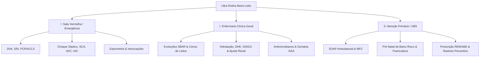

# 📋 Inventário Clínico Geral e Matriz de Escopo

**Assistente Clínico Ultra Rotina & Cockpit PWA**  
*Edição Especializada para o Internato Médico e Médico Generalista (Atenção Primária, Enfermaria e Sala Vermelha)*

---

## 1. Visão Geral e Arquitetura de Escopo

O **Ultra Rotina** foi estritamente saneado e calibrado para a prática assistencial direta do **estudante de internato** e do **médico generalista**. O sistema opera em alta velocidade (< 15ms para rotas determinísticas em RAM) e divide-se em três pilares fundamentais da prática médica geral, eliminando qualquer burocracia administrativa ou procedimentos cirúrgicos terciários que não pertençam ao médico na ponta:

---

## 2. Os Três Pilares Essenciais Beira-Leito

### 🚨 Pilar 1: Porta de Emergência / Sala Vermelha
* **Foco Clínico**: Estabilização inicial, conduta imediata e tomada de decisão nas primeiras horas de atendimento crítico.
* **Módulos Centrais**:
  - `CalculadorasClinicas.drogasVasoativas`: Noradrenalina (padrão e concentrada), Dobutamina, Vasopressina com vazão calculada em mL/h por peso.
  - `CalculadorasClinicas.sequenciaRapidaIntubacao`: SRI com cálculo em mg e mL (Etomidato, Quetamina, Propofol, Succinilcolina, Rocurônio).
  - `EmergenciaChoqueSepticoCirciService`: Choque séptico refratário, titulação de vasopressores, indicação de Hidrocortisona e desmame.
  - `CardiologiaEmergenciaService`: Escore HEART, TIMI, dupla antiagregação (DAPT) e estratificação de SCA.
  - `NeurologiaAvcService`: Elegibilidade para trombólise IV (rtPA/TNK) dentro da janela de 4.5h e manejo de hipertensão intracraniana (HIC) com Salina 3% e Manitol.
  - `GasometriaAcidoBaseService`: Análise ácido-base em 5 passos, fórmula de Winter, Ânion Gap corrigido e gradiente alvéolo-arterial.
  - `PalsPediatriaService`: Reanimação avançada pediátrica, seleção de tubo endotraqueal, Joules de desfibrilação e drogas de PCR por peso/idade.
  - `ToxicologiaEmergenciaService`: Intoxicações por paracetamol (Rumack-Matthew e NAC), opioides (naloxona) e antidepressivos tricíclicos.

### 🏥 Pilar 2: Enfermaria Clínica Geral
* **Foco Clínico**: Evolução médica diária, passagem de plantão, ajuste hidroeletrolítico, controle de comorbidades e segurança farmacológica.
* **Módulos Centrais**:
  - `EnfermariaService`: Censo de leitos, passagem de plantão estruturada no padrão SBAR e pitch de round.
  - `NefrologiaClearanceService` & `NefrologiaLraKdigoService`: Clearance de Creatinina (Cockcroft-Gault), estadiamento KDIGO e indicações clássicas de diálise (AEIOU).
  - `NefrologiaDheService`: Correção de hiponatremia com teto de segurança (< 8-10 mEq/L/24h) e manejo escalonado de hipercalemia com cardioproteção imediata.
  - `PneumologiaDpocVniService`: Critérios de Anthonisen para exacerbação de DPOC e indicações de VNI.
  - `SaudeIdosoService`: Avaliação Geriátrica Ampla (AGA), escala CFS de fragilidade, critérios de Beers/STOPP-START e revisão de polifarmácia/quedas.
  - `HematologiaAnemiasService`: Investigação etiológica de anemia microcítica/normocítica/macrocítica e cálculo de reposição de ferro (Ganzoni).

### 🩺 Pilar 3: Atenção Primária / UBS (Ambulatório & APS)
* **Foco Clínico**: Medicina de Família e Comunidade, puericultura, rastreio pré-natal de baixo risco, controle de HAS/DM e prescrição orientada pela REMUME.
* **Módulos Centrais**:
  - `SoapAmbulatorialService`: Atendimento estruturado SOAP, raciocínio clínico e diagnóstico diferencial na APS.
  - `ObstetriciaPrenatalService`: Cálculo de IG e DPP (Naegele), cronograma de exames do Ministério da Saúde e interpretação de sorologias (Toxoplasmose, VDRL, HIV).
  - `PuericulturaPediatricaService`: Acompanhamento de crescimento, marcos do desenvolvimento neuropsicomotor e vacinação.
  - `GinecologiaAmbulatorialService`: Critérios Médicos de Elegibilidade da OMS para Contracepção (Categorias 1 a 4), conduta citopatológica de colo uterino (INCA/MS) e abordagem sindrômica de corrimento vaginal.
  - `EndocrinologiaDiabetesService`: Metas de HbA1c, titulação de insulina NPH e Regular, antidiabéticos orais da REMUME e alertas contra hipoglicemia.
  - `OncologiaBasicaService`: Rastreamento populacional do câncer (Mama, Cólon, Próstata e Pulmão) segundo diretrizes nacionais do INCA.

---

## 3. Catálogo Canônico de 97 Comandos Slash do Telegram

Os comandos canônicos foram organizados em 17 categorias funcionais acessíveis via `/ajuda`:

| Categoria | Comandos Canônicos | Descrição Clínica |
|---|---|---|
| **🧭 Núcleo & Cockpit** | `/menu`, `/ajuda`, `/novo`, `/status`, `/pc` | Navegação, manual, reset de memória do caso e status dos servidores. |
| **🩺 Ambulatório & SOAP** | `/soap`, `/ambulatorio`, `/atestado`, `/rx`, `/rxh` | Raciocínio clínico SOAP, atestado médico e prescrição ambulatorial/hospitalar. |
| **🚨 Emergência / CTI** | `/emergencia`, `/choqueseptico`, `/dva`, `/sri`, `/conduta`, `/gaso`, `/winter`, `/choque`, `/sca`, `/avc`, `/hic`, `/intox`, `/pancreatite`, `/colica` | Central de Sala Vermelha, DVA, intubação, PCR, gasometria, IAM, AVC e toxíndromes. |
| **💊 Farmaco & Doses** | `/dose`, `/atb`, `/crcl`, `/interacao` | Consulta posológica no Guia HSL, ajuste renal de antibióticos e checagem de interações. |
| **👶 Pediatria & Suporte** | `/ped`, `/conduta_ped`, `/pals`, `/bronquiolite`, `/nutriped`, `/diluicao` | Posologia pediátrica por peso, PALS, bronquiolite viral, Holliday-Segar e fórmulas infantis. |
| **🤰 Obstetrícia & Feto** | `/prenatal`, `/parto`, `/hpp`, `/mgso4`, `/gbs`, `/prematuridade`, `/toxo` | Pré-natal, assistência ao parto no CO, hemorragia pós-parto, Zuspan, GBS e toxoplasmose. |
| **🌸 Ginecologia & Mulher** | `/ginecologia`, `/preventivo`, `/sua`, `/anticoncepcao`, `/corrimento`, `/endometriose` | Papanicolau/citologia, SUA (PALM-COEIN), contracepção OMS, vaginoses e endometriose. |
| **👴 Geriatria (AGA)** | `/idoso`, `/cfs`, `/beers`, `/frax`, `/osteoporose`, `/quedas`, `/polifarmacia` | Avaliação Geriátrica Ampla, fragilidade CFS, critérios de Beers, FRAX e risco de quedas. |
| **🫀 Cardio & Pneumo** | `/fa`, `/icc`, `/asma`, `/dpoc` | Fibrilação atrial (CHA2DS2-VASc), ICFEr (4 pilares), crise asmática e DPOC (GOLD/Anthonisen). |
| **🩸 Metabolismo & Sangue** | `/anemia`, `/ganzoni`, `/diabetes`, `/ehh`, `/glicemia` | Investigação de anemias, ferro IV (Ganzoni), diabetes basal-bolus, EHH e mapa hospitalar. |
| **🦴 Especialidades** | `/monoartrite`, `/febrereumatica`, `/oftalmo`, `/vertigem`, `/epistaxe` | Artrite séptica vs gota, critérios de Jones, trauma/glaucoma ocular, HINTS e epistaxe. |
| **🧴 Dermato & ISTs** | `/dermato`, `/ulceragenital`, `/mpox` | Lesões elementares da pele, úlceras genitais (sífilis, cancro, herpes) e Mpox. |
| **🧠 Psiquiatria de Urgência** | `/psiq`, `/agitacao`, `/suicidio`, `/phq9` | Emergências psiquiátricas, agitação psicomotora, risco de suicídio e escore PHQ-9. |
| **🩺 Exame Físico** | `/ef` | Menu central unificado com botões interativos para as 11 especialidades do exame físico. |
| **🏥 Enfermaria & Plantão** | `/enfermaria`, `/leito`, `/alta`, `/limpar_enfermaria`, `/passagem`, `/plantao`, `/plantao_fim`, `/round` | Censo diário, gestão de leitos, passagem de plantão SBAR e pitch de round. |
| **🎧 Preceptor & Rotina** | `/voz`, `/duvida`, `/rotina`, `/agenda`, `/task`, `/tasks`, `/briefing`, `/checkin`, `/semana` | Sabatina socrática em áudio/texto, Google Calendar, Notion e acompanhamento diário. |
| **🛡️ Governança & Diretrizes**| `/protocolo`, `/calc`, `/perfil`, `/pendencias`, `/chancelar`, `/kaizen`, `/breaktheglass` | Diretrizes comparadas, catálogo de calculadoras, perfil clínico RBAC e segurança do paciente. |

---

## 4. Matriz de Expurgo e Critérios de Encaminhamento Terciário

Para preservar a máxima relevância e segurança do médico generalista e interno, foram aplicados critérios estritos de expurgo de funções desnecessárias e salvaguardas explícitas de encaminhamento:

### ❌ O que foi Expurgado / Desativado
1. **Ferramentas Administrativas / Burocráticas**:
   - Desativados `/auditar_rbac` e `/relatorio_rbac` (rotinas de relatórios de governança que poluiam a assistência).
   - O comando `/emergencia` foi desvinculado do RBAC break-the-glass e restaurado como central de Sala Vermelha beira-leito.
   - O comando `/kaizen` foi despojado de rotinas de faturamento/DRG hospitalar em lote, focando estritamente em segurança farmacológica (ISMP).
2. **Procedimentos Cirúrgicos Terciários**:
   - Pós-operatórios de transplantes de órgãos sólidos e dosagem fina de imunossupressores específicos.
   - Cirurgias reconstrutivas pós-bariátricas complexas.
3. **Comandos Conflitantes e Redundantes**:
   - Expurgo dos comandos individuais `/ef_*`, centralizando 100% no comando canônico `/ef`.
   - Remoção de atalhos e aliases espúrios (`/pc tenda`, comandos de radar de voos).

### ⚠️ Salvaguardas e Condutas Exclusivas de UTI Terciária
Quando o paciente atinge critérios de gravidade extrema, o assistente emite alertas sentinela indicando a conduta do generalista e a **obrigatoriedade de acionamento imediato de vaga de CTI**:

| Cenário Clínico | Conduta Beira-Leito (PS / Enfermaria) | Conduta Exclusiva de UTI Terciária (CTI) |
|---|---|---|
| **SDRA Grave (P/F < 150)** | Ventilação mecânica protetora (Vt 4-6 mL/kg PBW, Pplat ≤ 30, ΔP ≤ 15). Solicitar **Vaga Zero / CTI**. | Posição Prona precoce (16h/dia) e Bloqueio Neuromuscular Contínuo (Cisatracúrio). ECMO venovenosa. |
| **Sedação Profunda (RASS ≤ -4)** | Manter via aérea protegida com TOT. Contraindicado manter em enfermaria geral. | Sedação profunda contínua com bomba de infusão e monitorização de bloqueio neuromuscular (TOF). |
| **Choque Vasoplégico Refratário** | Noradrenalina titulada + Vasopressina 0,03 UI/min + Hidrocortisona 200 mg/dia. Acionar CTI urgente. | Doses supramáximas, infusão de Azul de Metileno ou suporte circulatório mecânico (ECMO VA). |
| **CIG Grave (Ácidos Biliares ≥ 40)** | Iniciar Ácido Ursodesoxicólico 15 mg/kg/dia e monitorar vitalidade fetal (CTG). | Encaminhamento imediato para Maternidade Terciária de Alto Risco com UTI Neonatal. |
| **Glaucoma Agudo / Trauma Ocular** | Manitol 20% IV + Timolol colírio 0,5% + Acetazolamida 500 mg VO ou irrigação copiosa (queimadura). | Avaliação oftalmológica urgente e intervenção cirúrgica (iridotomia / descompressão). |

---

## 5. Auditoria de Rotas Fastify RPC do Cockpit

Todas as 133 rotas Fastify RPC registradas em `src/13_cockpit_integracao.js` e despachadas por `server/runtime.js` foram mapeadas e operam com resiliência total contra entradas nulas ou vazias, atendendo às necessidades do Cockpit PWA:

* **Núcleo & Sessão**: `cockpitConsultar`, `cockpitPerfil`, `cockpitStatusLeito`, `cockpitPassagem`, `cockpitRemume`, `cockpitConversar`.
* **Emergência & Cálculos**: `cockpitCalcular`, `cockpitChoqueSeptico`, `cockpitGasometriaAcidoBase`, `cockpitDva`, `cockpitSri`, `cockpitNeurologiaAvc`, `cockpitToxicologiaEmergencia`.
* **Ambulatório & Atenção Primária**: `cockpitSoapAmbulatorial`, `cockpitGerarReceitaTexto`, `cockpitGerarAtestadoTexto`, `cockpitBuscarCid`, `cockpitCalcularPrenatal`, `cockpitPainelPuericultura`.
* **Especialidades Médicas**: `cockpitGeriatriaAvancada`, `cockpitOftalmologiaEmergencia`, `cockpitOtorrinoResumo`, `cockpitReumatologiaMonoartrite`, `cockpitDermatologiaLesao`.
