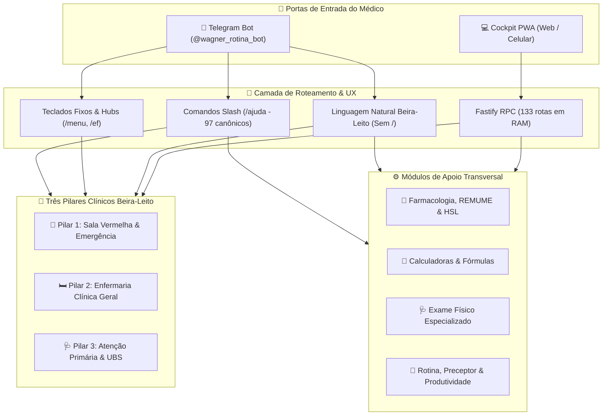
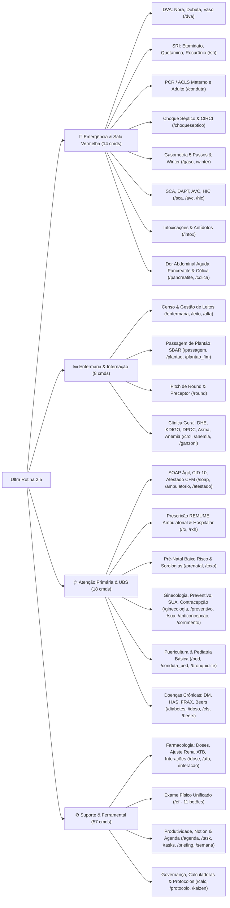
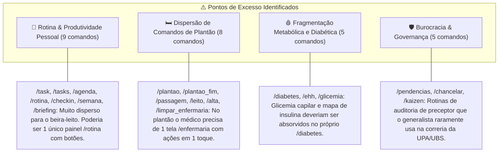
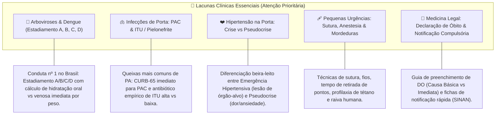

# 🗺️ Mapa Mental & Fluxograma Estrutural do Ultra Rotina

> **Documento de Governança Clínica e Arquitetura de Usabilidade**  
> *Versão: 2.5 · Foco: Internato Médico e Médico Generalista*

---

## 1. Visão Global de Acesso e Roteamento

Este fluxograma ilustra como uma solicitação médica entra no sistema, é interpretada e despachada para os motores determinísticos locais em RAM (< 15ms) ou para os motores de inteligência.

---

## 2. Mapa Mental Completo da Estrutura Atual

O sistema atual está dividido em **17 categorias no Telegram (97 comandos canônicos)** e **4 abas operacionais no Cockpit PWA**:

---

## 3. Diagnóstico Crítico: Onde tem EXCESSO (Gordura / Redundância)

Ao analisar a dispersão dos 97 comandos canônicos e das rotas do sistema sob a ótica de um **médico generalista e interno**, identificamos os seguintes pontos de sobrecarga cognitiva:

### Detalhamento dos Excessos:

1. **Hiperfragmentação da Categoria 16 (Preceptor & Rotina):**
   * Atualmente conta com **9 comandos**: `/voz`, `/duvida`, `/rotina`, `/agenda`, `/task`, `/tasks`, `/briefing`, `/checkin`, `/semana`.
   * **Problema:** Um médico em plantão ou na UBS não quer digitar comandos separados para listar tarefas, ver agenda ou dar check-in.
   * **Recomendação:** Unificar em `/rotina` (com botões: `📅 Agenda`, `📋 Tarefas`, `☀️ Briefing`, `🎙️ Preceptor`).

2. **Proliferação de Comandos na Enfermaria (Categoria 15):**
   * Atualmente conta com **8 comandos**: `/enfermaria`, `/leito`, `/alta`, `/limpar_enfermaria`, `/passagem`, `/plantao`, `/plantao_fim`, `/round`.
   * **Problema:** `/plantao` e `/plantao_fim` são apenas marcadores de horário, e `/alta` ou `/leito` podem ser botões inline dentro do censo da `/enfermaria`.
   * **Recomendação:** O comando `/enfermaria` deve ser o cockpit único, contendo botões interativos para `➕ Adicionar Leito`, `📤 Dar Alta`, `📋 Passagem SBAR` e `🎙️ Pitch de Round`.

3. **Duplicidade em Queixas Abdominais Agudas:**
   * `/pancreatite` e `/colica` (cólica nefrética) estão soltas como comandos de barra isolados dentro de Emergência CTI.
   * **Recomendação:** Agrupar sob uma abordagem sindrômica de **Dor Abdominal Aguda** ou manter integradas na busca de condutas.

---

## 4. Diagnóstico Crítico: Onde tem FALTA (Lacunas Clínicas Essenciais)

O assistente possui um nível avançado em terapia intensiva (DVA, SRI, SDRA, KDIGO, Circi), mas possui **lacunas de alta prevalência** na rotina do generalista de UPA, Pronto Atendimento e UBS:

### Detalhamento das Lacunas que Devem ser Priorizadas:

1. **🦟 Protocolo de Dengue / Chikungunya (Gravíssimo Faltar no Brasil):**
   * O generalista lida diariamente com suspeita de dengue.
   * **O que precisa ter:** Classificação em Grupos **A** (ambulatorial), **B** (leito de observação/plaquetometria), **C** (hidratação venosa imediata 10 mL/kg/h) e **D** (choque com expansão 20 mL/kg em 20 min).

2. **🫁 Infecções Comunitárias de Porta (PAC & ITU):**
   * Embora exista `/atb`, falta uma abordagem sindrômica orientada à porta:
     * **Pneumonia Adquirida na Comunidade (PAC):** Cálculo direto do `CURB-65`, indicação de tratamento ambulatorial (Amoxicilina + Clavulanato / Azitromicina) vs internação (Ceftriaxona + Claritromicina).
     * **ITU & Pielonefrite:** Diferenciação cistite não complicada (Fosfomicina / Nitrofurantoína) vs pielonefrite ambulatorial (Ciprofloxacino) vs hospitalar (Ceftriaxona).

3. **❤️ Crise Hipertensiva vs Pseudocrise Hipertensiva:**
   * Uma das queixas mais frequentes em Pronto Socorro. O assistente precisa de um algoritmo claro:
     * PA elevada + ausência de lesão de órgão-alvo = **Pseudocrise** (analgesia, repouso, sem necessidade de anti-hipertensivo IV).
     * PA elevada + EAP / Dissecção / Encefalopatia = **Emergência** (Nitroprussiato de Sódio titulado).

4. **🩹 Pequenas Urgências e Traumatologia Básica:**
   * Generalista em UPA atende ferimentos cortocontusos e quedas:
     * Regras de Ottawa para indicação de Raio-X de tornozelo/joelho.
     * Tabela rápida de fios cirúrgicos, doses máximas de Lidocaína (com e sem vasoconstritor) e profilaxia de Tétano/Raiva.

5. **📄 Medicina Legal & Prática Burocrática Beira-Leito:**
   * Preenchimento de **Declaração de Óbito (DO)**: Guia passo a passo (o que colocar na linha a, b, c e causa básica; quando encaminhar para SVO vs IML).
   * Lista rápida de **Doenças de Notificação Compulsória Imediata** (24h) pelo Ministério da Saúde.

---

## 5. Matriz de Rebalanceamento Recomendada (Plano de Ação)

| Área / Categoria | Estado Atual | Diagnóstico | Ação Sugerida |
| :--- | :---: | :---: | :--- |
| **🚨 Emergência & Sala Vermelha** | 14 comandos | Forte & Maduro | Manter como está; agrupar `/pancreatite` e `/colica` em dor abdominal. |
| **🫁 Infecções Comunitárias** | Disperso em `/atb` | ⚠️ **FALTA** | Criar protocolo integrado de **PAC (CURB-65)** e **ITU/Pielonefrite**. |
| **🦟 Arboviroses / Dengue** | Inexistente | 🚨 **FALTA CRÍTICA** | Criar módulo determinístico de **Dengue A/B/C/D** com hidratação por peso. |
| **❤️ HAS / Crise Hipertensiva** | Inexistente | ⚠️ **FALTA** | Criar fluxograma de **Pseudocrise vs Emergência Hipertensiva**. |
| **🛏️ Enfermaria & Leitos** | 8 comandos | 🟡 **EXCESSO** | Fundir rotinas em 1 comando `/enfermaria` com botões interativos. |
| **📅 Rotina & Produtividade** | 9 comandos | 🟡 **EXCESSO** | Fundir rotinas em 1 hub `/rotina` com inline keyboard. |
| **🩸 Diabetes & Metabolismo** | 5 comandos | 🟡 **EXCESSO** | Integrar `/glicemia` e `/ehh` dentro do painel `/diabetes`. |
| **🩹 Pequenas Urgências / Sutura** | Inexistente | ⚠️ **FALTA** | Adicionar módulo de **Suturas, Lidocaína e Regras de Ottawa**. |
| **📄 Declaração de Óbito & Notificação** | Inexistente | ⚠️ **FALTA** | Adicionar guia beira-leito para preenchimento de **DO e SINAN**. |

---

## 6. Próximos Passos Recomendados

1. **Enxugar Excesso de Botões/Comandos:** Compactar as categorias de *Enfermaria* (de 8 para 2 comandos) e *Rotina* (de 9 para 2 comandos) usando botões no próprio Telegram.
2. **Preencher as Lacunas Clínicas:** Implementar os 3 módulos de maior peso epidemiológico no Brasil para o médico generalista: **Dengue A-D**, **PAC/ITU** e **Crise Hipertensiva**.
3. **Consolidar no Cockpit:** Espelhar essas melhorias na aba de calculadoras e condutas rápidas do Cockpit PWA.
