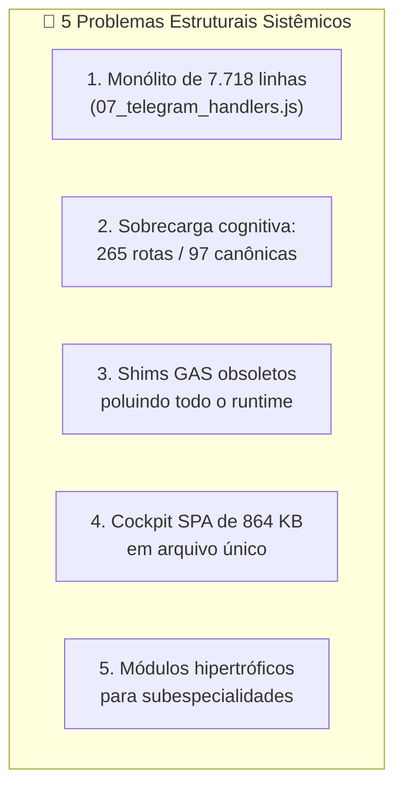
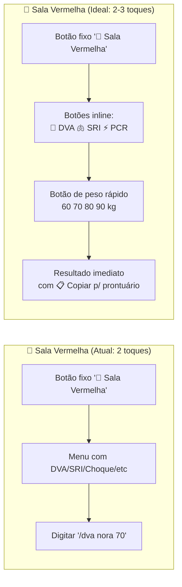

# 🏥 Análise Holística & Plano Diretor — Ultra Rotina 2.5

> **Documento de Análise Estratégica e Roteiro de Execução**
> *Autor: Claude Opus (Médico Auditor Chefe, Arquiteto de Software e Especialista em Informática em Saúde)*
> *Executor Designado: Gemini*
> *Data: 09 de outubro de 2026*

---

## Sumário Executivo

O Ultra Rotina 2.5 é um sistema de assistência clínica beira-leito notavelmente maduro: **54.344 linhas de código-fonte**, **57 módulos clínicos determinísticos**, **134 funções RPC do Cockpit**, **265 entradas de roteamento Telegram** (97 canônicas), **211 arquivos de teste** e um **Cockpit PWA** de 864 KB com 6 abas operacionais. A arquitetura dual (Telegram Bot + Cockpit) atende dois cenários distintos e complementares. Os motores determinísticos em RAM garantem latências de < 15ms para cálculos puros.

No entanto, a análise revela **5 problemas estruturais sistêmicos** e **6 lacunas clínicas epidemiologicamente críticas** que, se não endereçados, comprometem a ergonomia beira-leito (onde cada segundo conta) e a relevância clínica para o médico generalista no Brasil.

---

## Parte I — Avaliação da Arquitetura Geral

### 1.1. Pontos Fortes Consolidados

| Aspecto | Avaliação | Evidência |
|:---|:---:|:---|
| **Performance determinística** | ✅ Excelente | Cálculos puros em RAM < 15ms (DVA, SRI, CrCl, Gaso, PALS) |
| **Resiliência defensiva** | ✅ Excelente | 211 testes; handler global com try/catch; sanitização de edge cases clínicos em 38 cenários |
| **Segurança farmacológica** | ✅ Excelente | Tetos de NAC, nonagenários, neonatos < 1 kg, K+ > 8.0, pH < 6.80, Hb ≤ 4.0 |
| **Webhook durável** | ✅ Excelente | Checkpoint D1/local antes do ACK 200; fila serializada; contrapressão |
| **Preceptor Live** | ✅ Diferencial | WebSocket full-duplex com Gemini Live + contingência neural |
| **Blindagem de UX** | ✅ Sólida | `is_persistent: false`, typos corrigidos, entrada sem barra, cópia PEP |

### 1.2. Problemas Estruturais Sistêmicos



#### Problema 1: Monólito `07_telegram_handlers.js` (7.718 linhas / 414 KB)

**Diagnóstico**: Este arquivo concentra **toda** a lógica de roteamento, parsing de entrada, despacho clínico, formatação de saída e resposta Telegram. É o maior risco de manutenção do projeto. Um erro de sintaxe em qualquer ponto derruba **todos** os 265 comandos.

**Impacto**: Tempo de onboarding para novos contribuidores: alto. Risco de regressão em qualquer alteração: alto. Busca textual: penosa.

> [!IMPORTANT]
> **Recomendação**: Refatorar em módulos de handler por pilar clínico (`handlers/emergencia.js`, `handlers/enfermaria.js`, `handlers/ambulatorio.js`, `handlers/farmaco.js`, `handlers/especialidades.js`, `handlers/rotina.js`), com um roteador central enxuto de no máximo 200 linhas que despacha por prefixo de comando.

#### Problema 2: Sobrecarga Cognitiva de 265 Rotas

**Diagnóstico**: A superfície de 265 entradas de roteamento (incluindo aliases) é impressionante em abrangência, mas **nenhum médico em plantão vai memorizar 97 comandos canônicos**. O catálogo de `/ajuda` lista 97 itens em 17 categorias — isto é um manual, não uma interface de uso rápido.

**Dado empírico**: Estudos de cognitive load em interfaces médicas (Sittig & Singh, JAMIA 2010) demonstram que **interfaces com mais de 7±2 opções visíveis** reduzem a eficácia de decisão sob estresse. No plantão, o médico precisa de **3 a 5 ações imediatas** por cenário, não de 97 opções.

**O que já funciona bem**: O teclado fixo de 6 botões (Sala Vermelha, Enfermaria, Ambulatório, Consultas de Bolso, Cockpit, Menu) é a **decisão de UX correta**. O Hub Principal com 4 cenários + calculadoras é ergonômico.

**O que precisa melhorar**: Dentro de cada cenário, o médico ainda é jogado num texto longo com exemplos de comandos de barra. Deveria ser substituído por **botões inline de 1 toque** para as 5 ações mais comuns daquele cenário.

#### Problema 3: Shims GAS Obsoletos

**Diagnóstico**: `src/01_utils.js` ainda declara shims de compatibilidade para `Logger`, `PropertiesService`, `Utilities`, `CalendarApp`, `CacheService` e `LockService` — todos resquícios da arquitetura Google Apps Script **descontinuada**. Estes shims poluem o escopo global, adicionam complexidade de depuração e violam a diretiva de proibição absoluta de GAS.

> [!WARNING]
> **Recomendação**: Substituir gradualmente por módulos Node.js nativos. `LockService` → mutex simples em memória (já é single-threaded). `CacheService` → Map com TTL. `PropertiesService` → dotenv + JSON local. `Utilities.formatDate` → Intl.DateTimeFormat.

#### Problema 4: Cockpit SPA de 864 KB em Arquivo Único

**Diagnóstico**: `gh_cockpit_deploy/index.html` é um SPA monolítico de 864 KB que empacota HTML + CSS + JavaScript + lógica clínica em um único arquivo. Isso dificulta:
- Cache granular do navegador (qualquer mudança invalida os 864 KB)
- Manutenção e depuração
- Carregamento progressivo (tudo ou nada)

**Recomendação para o futuro (não urgente)**: Quando houver janela, migrar para build com Vite/esbuild mínimo que gere `app.js`, `app.css` e `index.html` separados. Prioridade baixa — o sistema funciona.

#### Problema 5: Módulos Hipertróficos para Subespecialidades

**Diagnóstico**: Alguns módulos ultrapassam significativamente o escopo do médico generalista:

| Módulo | Linhas | Questionamento |
|:---|:---:|:---|
| `02_calculadoras_puras.js` | 2.787 | Justificado — é o core do sistema |
| `02_obstetricia_prenatal.js` | 1.817 | Excessivo — abrange alta complexidade obstétrica |
| `02_ginecologia_ambulatorial.js` | 1.108 | Razoável, mas inclui condutas terciárias |
| `02_sop_ovarios_policisticos.js` | 1.074 | Subespecialidade endocrinológica — deveria ser sumário + encaminhamento |
| `02_climaterio_thm.js` | 995 | Climatério/THM é especialidade — deveria ser sumário + encaminhamento |
| `02_dip_abscesso_tubo_ovariano.js` | 1.028 | Subespecialidade cirúrgica — deveria ser diagnóstico + encaminhamento imediato |
| `02_centro_obstetrico.js` | 966 | Centro obstétrico é condução exclusiva de obstetra |
| `02_obstetricia_rcf_doppler.js` | 724 | Doppler fetal é ultrassonografia especializada |
| `02_obstetricia_saf_trombofilias.js` | 782 | SAF gestacional requer hematologista/pré-natal alto risco |
| `02_tev_gestante.js` | 673 | TEV gestante requer equipe terciária |
| `02_auditoria_infusao_uti.js` | 895 | Auditoria de infusão é rotina exclusiva de UTI |
| `02_auditoria_kaizen_clinico.js` | 930 | Kaizen clínico é governança de preceptoria, não beira-leito |
| `02_rbac_perfis_clinicos.js` | 930 | RBAC é infraestrutura administrativa |

> [!CAUTION]
> **Total de linhas em módulos questionáveis para o generalista: ~10.994 linhas (~32% do código clínico)** que atendem situações onde o generalista deveria encaminhar ao especialista, não conduzir sozinho.

---

## Parte II — Diagnóstico de Excessos: O Que Enxugar

### 2.1. Categoria "Enfermaria" (8 comandos → 2 recomendados)

| Comando Atual | Proposta |
|:---|:---|
| `/enfermaria` | ✅ **Manter** — Hub único com botões inline |
| `/leito` | 🔄 **Absorver** como botão `➕ Adicionar Leito` dentro de `/enfermaria` |
| `/alta` | 🔄 **Absorver** como botão `📤 Dar Alta` dentro de `/enfermaria` |
| `/limpar_enfermaria` | 🔄 **Absorver** como botão `🗑️ Limpar Todos` (com confirmação) |
| `/passagem` | ✅ **Manter** como comando direto E botão `📋 Passagem SBAR` em `/enfermaria` |
| `/plantao` | 🔄 **Absorver** como botão `🟢 Iniciar Plantão` em `/enfermaria` |
| `/plantao_fim` | 🔄 **Absorver** como botão `🏁 Fim de Plantão` no teclado fixo (já existe!) |
| `/round` | 🔄 **Absorver** como botão `🎙️ Pitch de Round` em `/enfermaria` |

**Resultado**: De 8 comandos digitados → **2 comandos (`/enfermaria`, `/passagem`) + 6 botões inline de 1 toque.**

### 2.2. Categoria "Rotina & Produtividade" (9 comandos → 2 recomendados)

| Comando Atual | Proposta |
|:---|:---|
| `/rotina` | ✅ **Manter** — Hub único com botões |
| `/agenda` | 🔄 Botão `📅 Agenda Hoje` dentro de `/rotina` |
| `/task` / `/tasks` / `/tarefa` | 🔄 Botão `📋 Tarefas` dentro de `/rotina` |
| `/briefing` | 🔄 Botão `☀️ Briefing Matinal` dentro de `/rotina` |
| `/checkin` | 🔄 Botão `🌙 Check-in` dentro de `/rotina` |
| `/semana` | 🔄 Botão `📊 Semana` dentro de `/rotina` |
| `/voz` | ✅ **Manter** como comando direto (Preceptor Socrático é feature core) |
| `/duvida` | 🔄 Botão `🧠 MedQuest` dentro de `/rotina` |

**Resultado**: De 9 comandos → **2 comandos (`/rotina`, `/voz`) + 7 botões inline.**

### 2.3. Categoria "Governança" (5 comandos → 2 recomendados)

| Comando Atual | Proposta |
|:---|:---|
| `/protocolo` | ✅ **Manter** — consulta de diretrizes é valiosa |
| `/calc` | ✅ **Manter** — catálogo de calculadoras é valiosa |
| `/pendencias` | 🔄 Absorver como subcomando de `/rotina` |
| `/chancelar` | ❌ **Remover** — rotina de preceptoria raramente usada na UPA/UBS |
| `/kaizen` | 🔄 **Simplificar** — manter apenas checklist ISMP de segurança farmacológica |

### 2.4. Categoria "Metabolismo & Sangue" (5 → 3 recomendados)

| Comando Atual | Proposta |
|:---|:---|
| `/diabetes` | ✅ **Manter** como hub com botões para CAD, EHH e Mapa Glicêmico |
| `/ehh` | 🔄 Botão `🔥 EHH/CAD` dentro de `/diabetes` |
| `/glicemia` | 🔄 Botão `📊 Mapa Glicêmico` dentro de `/diabetes` |
| `/anemia` | ✅ **Manter** |
| `/ganzoni` | 🔄 Botão `💉 Ferro IV (Ganzoni)` dentro de `/anemia` |

### 2.5. Módulos para Enxugar/Congelar (Subespecialidades)

> [!TIP]
> **Não deletar** — congelar e rotular como "Módulo de Referência Avançada" com banner claro indicando `⚠️ Encaminhar ao especialista. Informações de referência para discussão em round/preceptoria.`

Módulos candidatos ao congelamento com banner:
- `02_climaterio_thm.js` — THM é decisão de ginecologista
- `02_sop_ovarios_policisticos.js` — SOP requer follow-up endocrino/gineco
- `02_dip_abscesso_tubo_ovariano.js` — ATO é cirúrgico
- `02_centro_obstetrico.js` — CO é condução obstétrica
- `02_obstetricia_rcf_doppler.js` — Doppler é ultrassonografia especializada
- `02_obstetricia_saf_trombofilias.js` — SAF requer hematologista
- `02_tev_gestante.js` — TEV gestante requer equipe terciária
- `02_auditoria_infusao_uti.js` — Exclusivo de UTI
- `02_auditoria_kaizen_clinico.js` — Governança de preceptoria
- `02_rbac_perfis_clinicos.js` — Infraestrutura administrativa

---

## Parte III — Diagnóstico de Lacunas Clínicas Epidemiológicas

> [!CAUTION]
> **Critério de seleção**: São doenças ou situações com as quais **o generalista lida diariamente** no Brasil, especialmente em UPA, UBS e Pronto Atendimento, e que o sistema atual **não cobre ou cobre marginalmente**.

### 3.1. 🦟 Arboviroses / Dengue — LACUNA CRÍTICA Nº 1

**Justificativa epidemiológica**: O Brasil registrou **mais de 6 milhões de casos prováveis de dengue em 2024** (maior epidemia da história). A dengue é a **queixa nº 1 em pronto atendimento** em grande parte do ano. Chikungunya e Zika são co-circulantes.

**O que o sistema precisa ter** (novo módulo `02_arboviroses_dengue.js`):

```
Estadiamento clínico de Dengue (MS/OMS):
├── Grupo A: Sem sinais de alarme, sem comorbidades
│   → Hidratação oral 60 mL/kg/dia (1/3 SRO + 2/3 líquidos)
│   → Retorno em 48h ou se sinais de alarme
├── Grupo B: Sem sinais de alarme, COM comorbidades/risco social
│   → Hidratação oral supervisionada + hemograma + plaquetas
│   → Observação mínima de 6h na UPA
├── Grupo C: COM sinais de alarme (dor abdominal intensa, vômitos persistentes, 
│            acúmulo de líquidos, letargia, hipotensão postural, hepatomegalia, 
│            sangramento mucoso, aumento progressivo do hematócrito)
│   → Internação imediata em leito de observação
│   → SF 0,9% 10 mL/kg/h nas primeiras 2h, reavaliar
│   → Se melhora: 25 mL/kg em 6h de manutenção
│   → Se piora: tratar como Grupo D
└── Grupo D: Choque com ou sem hipotensão, sangramento grave,
             comprometimento grave de órgãos
    → Sala Vermelha / UTI
    → SF 0,9% 20 mL/kg em 20 min (até 3x)
    → Se refratário: Albumina ou Coloide
    → Monitorização de Ht a cada 2h
```

**Calculadora determinística necessária**: Receber peso (kg) → calcular volume oral (Grupo A/B) e venoso (Grupo C/D) em mL/h com template de prescrição.

### 3.2. 🫁 Infecções Comunitárias de Porta: PAC e ITU — LACUNA Nº 2

**Justificativa**: PAC e ITU são a **2ª e 3ª queixas mais comuns** em pronto atendimento e UBS.

**PAC — Pneumonia Adquirida na Comunidade** (novo módulo `02_pneumologia_pac.js`):
- Cálculo CURB-65 interativo (Confusão, Ureia > 50, FR ≥ 30, PAS < 90 ou PAD ≤ 60, Idade ≥ 65)
- 0-1: Ambulatorial → Amoxicilina ± Clavulanato (ou Azitromicina se alérgico)
- 2: Internação curta / Observação → Amoxicilina + Clavulanato VO ou Ceftriaxona
- 3-5: Internação obrigatória → Ceftriaxona 1g IV 12/12h + Azitromicina 500mg IV 1x/dia
- PORT/PSI simplificado como alternativa

**ITU — Infecção do Trato Urinário** (novo módulo `02_infectologia_itu.js`):
- Cistite não complicada em mulher: Fosfomicina 3g DU ou Nitrofurantoína 100mg 6/6h por 5 dias
- Cistite em gestante: Cefalexina 500mg 6/6h por 7 dias (1ª linha REMUME)
- Pielonefrite ambulatorial: Ciprofloxacino 500mg 12/12h por 7 dias (se sem vômitos)
- Pielonefrite hospitalar: Ceftriaxona 1g IV 12/12h
- ITU masculina: sempre investigar complicação; tratar por 7-14 dias
- Urocultura: quando solicitar e quando não solicitar

### 3.3. ❤️ Crise Hipertensiva vs Pseudocrise — LACUNA Nº 3

**Justificativa**: PA elevada é a **causa nº 1 de procura de pronto socorro no Brasil**. A maioria é pseudocrise (dor, ansiedade, medicação irregular), mas o generalista precisa diferenciar rapidamente.

**Observação**: O roteamento coloquial já captura "crise hipertensiva" e "has descompensada" com uma resposta rápida inline. Porém, isso é apenas um texto informativo estático, não um módulo estruturado com calculadoras e fluxograma interativo.

**Necessário** (novo módulo `02_emergencia_crise_hipertensiva.js`):
- Fluxograma interativo com botões: `PA ≥ 180×120? → Lesão de órgão-alvo? → SIM/NÃO`
- **Pseudocrise** (sem LOA): Repouso 30 min → Reavalia → Captopril 25 mg VO ou Clonidina 0.100 mg VO → Alta com ajuste ambulatorial
- **Urgência Hipertensiva** (sem LOA mas PA muito elevada): Captopril/Clonidina VO, redução em 24-48h
- **Emergência Hipertensiva** (COM LOA): Nitroprussiato de Sódio IV titulado (EAP, Encefalopatia, Dissecção)
- Exceções: AVC isquêmico (PA < 185/110 apenas se candidato a trombólise), Dissecção (PAS < 120 em 20 min)

### 3.4. 🤕 Cefaleias Agudas — Bandeiras Vermelhas (SNOOP) — LACUNA Nº 4

**Justificativa**: Cefaleia é a **queixa neurológica mais comum no PS**. O generalista precisa distinguir enxaqueca/cefaleia tensional (90%+) de HSA, meningite, trombose venosa cerebral e HIC.

**Necessário** (novo módulo `02_neurologia_cefaleias.js`):
- Checklist SNOOP interativo com botões:
  - **S**ystemic symptoms (febre, rigidez de nuca, perda de peso)
  - **N**eurologic signs (déficit focal, papiledema, convulsão)
  - **O**nset sudden (thunderclap → TCE? → HSA até provar o contrário)
  - **O**lder age (> 50 anos, primeira cefaleia → arterite temporal?)
  - **P**attern change (mudança de padrão da cefaleia habitual)
- Conduta para cefaleia benigna: Dipirona 1g IV + Metoclopramida 10mg IV + Dexametasona 4mg IV (se status migranoso)
- Bandeira vermelha → TC de crânio sem contraste → Punção lombar se TC normal e suspeita de HSA

### 3.5. 🩹 Pequenas Urgências / Traumatologia Básica — LACUNA Nº 5

**Justificativa**: O generalista de UPA atende **ferimentos cortocontusos, mordeduras e entorses diariamente**. Não há módulo de suporte.

**Necessário** (novo módulo `02_pequenas_urgencias_trauma.js`):
- **Regras de Ottawa** (Tornozelo e Joelho): 5 critérios interativos → Indicação ou não de Raio-X
- **Tabela de Fios Cirúrgicos**: Nylon 3-0 (face), 4-0 (membros), 5-0 (mãos/dedos) com tempo de retirada
- **Lidocaína**: Dose máxima sem vasoconstritor (4,5 mg/kg, max 300 mg) e com vasoconstritor (7 mg/kg, max 500 mg)
- **Profilaxia de Tétano**: Fluxograma por histórico vacinal (esquema completo vs incompleto vs desconhecido)
- **Profilaxia de Raiva**: Classificação do animal + tipo de lesão → Esquema com SAR e vacina antirrábica
- **Mordedura Humana/Animal**: Amoxicilina + Clavulanato profilático, NÃO suturar mordeduras exceto face

### 3.6. 📄 Declaração de Óbito e Notificação Compulsória — LACUNA Nº 6

**Justificativa**: Todo médico é obrigado a preencher DO e realizar notificações compulsórias. Erros são frequentes e têm implicações legais.

**Necessário** (novo módulo `02_medicina_legal_obito_notificacao.js`):
- **Declaração de Óbito**: Guia passo a passo para preenchimento das linhas a, b, c, d (causa imediata → causa básica)
  - Quando encaminhar para SVO (morte sem causa definida) vs IML (morte violenta/suspeita)
  - Fluxograma: Morte natural? → Causa definida? → DO pelo médico assistente. Causa indefinida? → SVO. Violenta/suspeita? → IML
- **Notificação Compulsória Imediata (24h)**: Lista rápida das doenças de notificação imediata pelo SINAN
  - Dengue grave (Grupos C e D), meningite, raiva humana, sarampo, difteria, coqueluche, botulismo, cólera, poliomielite
  - Como preencher a ficha SINAN online/física

---

## Parte IV — Auditoria de Ergonomia Beira-Leito

### 4.1. Análise da Jornada do Médico nos 3 Cenários



**Diagnóstico**: O menu de Sala Vermelha (`enviarMenuSalaVermelha`) já oferece botões, mas o fluxo de DVA com seletor de peso (`enviarTelaPesoDva` + `enviarTelaDiluicaoDva`) em 3 toques é **excelente**. O padrão de UX do `/ef` (11 botões com `callback_data`) deve ser replicado nos demais hubs.

### 4.2. Padrão de "1 Hub + N Botões" Recomendado

> [!TIP]
> **Regra de ouro**: Todo cenário clínico deve ser navegável em **no máximo 3 toques** do botão fixo até o resultado final. Nenhum médico deveria precisar digitar um comando com barra durante uma emergência.

**Implementação recomendada para cada hub**:

1. **Sala Vermelha** → Botões: `💉 DVA` | `🫁 SRI/IOT` | `⚡ PCR/ACLS` | `🩸 Gaso` | `🩸 Choque Séptico` | `❤️ SCA/IAM` | `🧠 AVC/HIC` | `🦟 Dengue Grave` | `❤️ Crise HAS`
2. **Enfermaria** → Botões: `📊 Censo` | `➕ Leito` | `📤 Alta` | `📋 SBAR` | `🎙️ Round` | `🟢 Iniciar Plantão` | `🏁 Fim Plantão`
3. **Ambulatório** → Botões: `📝 SOAP` | `💊 Receita` | `📜 Atestado` | `🤰 Pré-Natal` | `👶 Puericultura` | `🧓 Geriatria` | `💉 Diabetes`
4. **Consultas de Bolso** → Botões: `💊 ATB por Foco` | `👶 Dose Pediátrica` | `🤰 Fármaco na Gestação` | `⚠️ Interações` | `🩸 CrCl` | `📐 Calculadoras`

---

## Parte V — Plano Diretor de Execução para o Gemini

> [!IMPORTANT]
> Este plano é organizado em **3 fases sequenciais**, cada uma com entregas atômicas testáveis. **A Fase 1 não adiciona nenhuma funcionalidade nova** (em conformidade com a diretiva do usuário). As Fases 2 e 3 só devem ser executadas após aprovação explícita do usuário.

---

### FASE 1: Saneamento de Excessos e Lapidação de UX (Sem funcionalidades novas)

> **Objetivo**: Reduzir a carga cognitiva do médico sem alterar nenhum conteúdo clínico.
> **Prazo estimado**: 3 a 5 sessões de trabalho.

#### 1.1. Consolidar Hub da Enfermaria

**Arquivo**: `src/07_telegram_handlers.js` e `src/12_experiencia_bot.js`

**Ação técnica**:
1. Manter `/enfermaria` como hub principal com inline_keyboard contendo 6 botões:
   ```
   [[ ➕ Adicionar Leito ] [ 📤 Dar Alta ]]
   [[ 📋 Passagem SBAR ] [ 🎙️ Pitch de Round ]]
   [[ 🟢 Iniciar Plantão ] [ 🗑️ Limpar Todos ]]
   ```
2. Os comandos `/leito`, `/alta`, `/limpar_enfermaria`, `/plantao`, `/plantao_fim`, `/round` continuam funcionando como aliases diretos (não deletar para não quebrar hábitos), mas **não aparecem mais no catálogo de `/ajuda`** — são absorvidos no Hub.
3. Manter `/passagem` como comando autônomo (é o mais usado independentemente).

**Teste**: Verificar que todos os 6 botões do hub da enfermaria acionam a ação correta e que os comandos individuais continuam respondendo.

#### 1.2. Consolidar Hub de Rotina/Produtividade

**Arquivo**: `src/07_telegram_handlers.js` e `src/12_experiencia_bot.js`

**Ação técnica**:
1. Manter `/rotina` como hub principal com inline_keyboard:
   ```
   [[ 📅 Agenda Hoje ] [ 📋 Tarefas ]]
   [[ ☀️ Briefing ] [ 🌙 Check-in ]]
   [[ 📊 Semana ] [ 🧠 MedQuest ]]
   ```
2. Os comandos individuais (`/agenda`, `/task`, `/tasks`, `/briefing`, `/checkin`, `/semana`, `/duvida`) continuam como aliases silenciosos.
3. Manter `/voz` como comando autônomo (Preceptor Socrático é feature core).

#### 1.3. Consolidar Hub de Diabetes/Metabolismo

**Ação técnica**:
1. `/diabetes` com inline_keyboard:
   ```
   [[ 🔥 CAD / EHH ] [ 📊 Mapa Glicêmico Hospitalar ]]
   [[ 💉 Insulina Basal-Bolus ] [ 💊 Antidiabéticos REMUME ]]
   ```
2. `/anemia` com inline_keyboard:
   ```
   [[ 🔬 Investigação Etiológica ] [ 💉 Ferro IV (Ganzoni) ]]
   ```

#### 1.4. Simplificar Catálogo de `/ajuda`

**Ação técnica**:
1. Reduzir as 17 categorias para **10 categorias enxutas** no catálogo de `/ajuda`:
   - Núcleo & Cockpit (5)
   - Ambulatório & Prescrição (5)
   - Sala Vermelha & Emergência (13 → condensar pancreatite/cólica)
   - Farmacologia & Doses (4)
   - Pediatria (6)
   - Obstetrícia & Ginecologia (13 — fundir as duas categorias)
   - Geriatria / Saúde do Idoso (7)
   - Especialidades Médicas (12 — fundir cardio/pneumo/hemato/reumato/neuro/dermato/psiq/oftalmo/otorrino)
   - Enfermaria & Plantão (2 → `/enfermaria` + `/passagem`)
   - Preceptor & Rotina (2 → `/rotina` + `/voz`)

2. Os 5 comandos de governança (`/protocolo`, `/calc`, `/pendencias`, `/chancelar`, `/kaizen`) são absorvidos como subopções de `/calc` e `/rotina`, exceto `/protocolo` que se mantém.

#### 1.5. Adicionar Banners de Encaminhamento nos Módulos de Subespecialidade

**Ação técnica**: Em cada módulo listado na seção 2.5 acima, adicionar como **primeira linha** do output:
```
⚠️ *MÓDULO DE REFERÊNCIA AVANÇADA* — A conduta definitiva requer especialista.
O generalista deve reconhecer, estabilizar e encaminhar.
```

#### 1.6. Testes da Fase 1

- Atualizar `tests/test_simplificacao_e_expurgo_generalista.cjs` para validar:
  - Os hubs de Enfermaria, Rotina, Diabetes e Anemia retornam inline_keyboard com os botões corretos
  - Os aliases antigos (`/leito`, `/alta`, `/agenda`, etc.) continuam funcionando
  - O catálogo de `/ajuda` tem exatamente 10 categorias
  - Os módulos de subespecialidade incluem o banner de encaminhamento

---

### FASE 2: Implementação dos 6 Protocolos Clínicos Faltantes

> **Objetivo**: Preencher as lacunas epidemiológicas críticas.
> **Pré-requisito**: Aprovação explícita do usuário (pois adiciona funcionalidades novas).
> **Prazo estimado**: 5 a 8 sessões de trabalho.

> [!WARNING]
> Cada módulo deve seguir rigorosamente o padrão arquitetural existente: função determinística pura em `src/02_*.js`, handler Telegram em `src/07_telegram_handlers.js`, função RPC `cockpit*` em `src/13_cockpit_integracao.js`, e testes em `tests/`.

#### 2.1. Módulo de Dengue/Arboviroses

**Criar arquivo**: `src/02_arboviroses_dengue.js`

**Exportar**:
```javascript
var ArbovirosesDengueService = {
  estadiarDengue: function(sinaisAlarme, comorbidades, pesoKg, sinaisChoque) {
    // Retorna: { grupo: 'A'|'B'|'C'|'D', conduta, hidratacao, prescricao }
  },
  calcularHidratacaoDengue: function(grupo, pesoKg) {
    // Retorna: { volumeOral24h, volumeIV1aHora, volumeIVManutencao, prescricaoCompleta }
  }
};
```

**Handler Telegram**: `/dengue` (canônico), aliases: `/arbovirose`, `/chikungunya`, `/zika`
**Rota Cockpit**: `cockpitArbovirosesDengue`

**Conteúdo clínico obrigatório**:
- Classificação de risco A/B/C/D conforme MS 2024
- Sinais de alarme (lista completa de 7 itens)
- Hidratação calculada por peso para cada grupo
- Critérios de internação
- Prova do laço
- Quando solicitar plaquetas e hematócrito seriado
- Diferencial Dengue × Chikungunya × Zika (tabela comparativa)
- **Fonte**: Ministério da Saúde, Dengue: diagnóstico e manejo clínico — Adulto e Criança, 5ª edição, 2024

#### 2.2. Módulo de PAC

**Criar arquivo**: `src/02_pneumologia_pac.js`

**Exportar**:
```javascript
var PneumologiaPacService = {
  calcularCurb65: function(confusao, ureia, fr, pas, pad, idade) {
    // Retorna: { escore, classificacao, conduta, antibiotico, duracao }
  }
};
```

**Handler Telegram**: `/pac` (canônico), alias: `/pneumonia`
**Rota Cockpit**: `cockpitPneumologiaPac`

#### 2.3. Módulo de ITU

**Criar arquivo**: `src/02_infectologia_itu.js`

**Exportar**:
```javascript
var InfectologiaItuService = {
  conduzirItu: function(tipo, sexo, gestante, alergias) {
    // tipo: 'cistite_nao_complicada', 'cistite_gestante', 'pielonefrite_ambulatorial', 'pielonefrite_hospitalar', 'itu_masculina'
    // Retorna: { conduta, antibiotico, dose, duracao, alertas }
  }
};
```

**Handler Telegram**: `/itu` (canônico), aliases: `/cistite`, `/pielonefrite`, `/infeccaourinaria`
**Rota Cockpit**: `cockpitInfectologiaItu`

#### 2.4. Módulo de Crise Hipertensiva

**Criar arquivo**: `src/02_emergencia_crise_hipertensiva.js`

**Exportar**:
```javascript
var EmergenciaCriseHipertensivaService = {
  classificarCrise: function(pas, pad, lesaoOrgaoAlvo) {
    // lesaoOrgaoAlvo: { eap: bool, encefalopatia: bool, disseccao: bool, iam: bool, avcIsquemico: bool, eclampsia: bool }
    // Retorna: { classificacao: 'pseudocrise'|'urgencia'|'emergencia', conduta, medicacao, alvo }
  }
};
```

**Handler Telegram**: `/crisehipertensiva` (canônico), aliases: `/pseudocrise`, `/emergenciahipertensiva`, `/has`
**Rota Cockpit**: `cockpitEmergenciaCriseHipertensiva`

#### 2.5. Módulo de Cefaleias Agudas

**Criar arquivo**: `src/02_neurologia_cefaleias.js`

**Exportar**:
```javascript
var NeurologiaCefaleiasService = {
  avaliarBandeirasVermelhas: function(snoop) {
    // snoop: { sistemico, neurologico, onset_subito, older, pattern_change }
    // Retorna: { bandeirasPositivas, classificacao, conduta, investigacao }
  },
  tratarCefaleiaPS: function(tipo, intensidade) {
    // tipo: 'migrânea', 'tensional', 'cluster', 'status_migranosus'
    // Retorna: { medicacao, dose, via, orientacao_alta }
  }
};
```

**Handler Telegram**: `/cefaleia` (canônico), aliases: `/dorcabeca`, `/enxaqueca`, `/hsa`
**Rota Cockpit**: `cockpitNeurologiaCefaleias`

#### 2.6. Módulo de Pequenas Urgências e Trauma Básico

**Criar arquivo**: `src/02_pequenas_urgencias_trauma.js`

**Exportar**:
```javascript
var PequenasUrgenciasTraumaService = {
  regraOttawa: function(articulacao, criterios) {
    // articulacao: 'tornozelo' | 'joelho'
    // Retorna: { indicaRx, justificativa, orientacao }
  },
  lidocainaDoseMaxima: function(pesoKg, comVasoconstritor) {
    // Retorna: { doseMgMax, volumeMaxMl, concentracaoRecomendada }
  },
  profilaxiaTetano: function(historicoVacinal, ferimentoContaminado) {
    // Retorna: { vacina, imunoglobulina, justificativa }
  },
  profilaxiaRaiva: function(tipoAnimal, tipoLesao, statusAnimal) {
    // Retorna: { esquemaVacinal, sar, conduta }
  }
};
```

**Handler Telegram**: `/sutura` (canônico), aliases: `/ottawa`, `/tetano`, `/raiva`, `/mordedura`, `/ferimento`
**Rota Cockpit**: `cockpitPequenasUrgencias`

#### 2.7. Módulo de Declaração de Óbito e Notificação

**Criar arquivo**: `src/02_medicina_legal_obito_notificacao.js`

**Exportar**:
```javascript
var MedicinaLegalObitoService = {
  guiaDeclaracaoObito: function(tipoMorte) {
    // tipoMorte: 'natural_causa_definida' | 'natural_causa_indefinida' | 'violenta_acidental' | 'violenta_intencional' | 'fetal'
    // Retorna: { destino: 'medico_assistente'|'SVO'|'IML', instrucoes, exemploCausaMortis }
  },
  listarNotificacaoImediata: function() {
    // Retorna lista de doenças de notificação compulsória imediata (24h)
  }
};
```

**Handler Telegram**: `/obito` (canônico), aliases: `/declaracaoobito`, `/do`, `/notificacao`, `/sinan`
**Rota Cockpit**: `cockpitMedicinaLegalObito`

---

### FASE 3: Lapidação de UX e Refatoração Técnica

> **Objetivo**: Melhorias de arquitetura e experiência que aumentam a sustentabilidade do projeto.
> **Pré-requisito**: Fases 1 e 2 concluídas e estáveis.

#### 3.1. Refatorar Monólito de Handlers

**Ação**: Extrair `src/07_telegram_handlers.js` (7.718 linhas) em:
- `src/handlers/roteador_central.js` (~200 linhas) — pipeline de 6 estágios
- `src/handlers/emergencia.js` — DVA, SRI, Gaso, Choque, SCA, AVC, HIC, Intox, Dengue, Crise HAS
- `src/handlers/enfermaria.js` — Censo, SBAR, Round, Plantão
- `src/handlers/ambulatorio.js` — SOAP, Receita, Atestado, Pré-natal, Gineco
- `src/handlers/farmaco.js` — Dose, ATB, CrCl, Interação
- `src/handlers/especialidades.js` — Geriatria, Cardio, Pneumo, Reumato, Neuro, Dermato, Psiq, Oftalmo, Otorrino
- `src/handlers/rotina.js` — Agenda, Tasks, Briefing, Preceptor, Cockpit
- `src/handlers/coloquial.js` — `tentarRoteamentoColoquialPlantao`

**Critério de sucesso**: `npm test` passa 100%; nenhum comando regride.

#### 3.2. Eliminar Shims GAS

**Ação**: Criar wrappers Node.js nativos para substituir:
- `CacheService` → `src/infra/cache.js` (Map + TTL)
- `PropertiesService` → `src/infra/properties.js` (JSON file + env)
- `LockService` → `src/infra/lock.js` (mutex simples)
- `Utilities` → `src/infra/utils_node.js` (crypto, Intl, uuid)

#### 3.3. Atualizar Hub de Sala Vermelha com Novos Módulos

**Ação**: Adicionar botões para Dengue Grave, Crise HAS e PAC Grave no menu de Sala Vermelha:
```
[[ 💉 DVA ] [ 🫁 SRI/IOT ] [ ⚡ PCR ]]
[[ 🩸 Gaso ] [ 🩸 Choque Séptico ] [ ❤️ SCA ]]
[[ 🧠 AVC/HIC ] [ 🦟 Dengue C/D ] [ ❤️ Crise HAS ]]
```

#### 3.4. Espelhar no Cockpit PWA

**Ação**: Adicionar cards/botões nas abas do Cockpit para os novos módulos (Dengue, PAC, ITU, Crise HAS, Cefaleia, Sutura, Óbito).

---

## Parte VI — Matriz de Priorização Final

| # | Ação | Fase | Prioridade | Esforço | Impacto Clínico |
|:---:|:---|:---:|:---:|:---:|:---:|
| 1 | Consolidar Hub Enfermaria (8→2 + botões) | F1 | 🔴 Alta | Baixo | Médio |
| 2 | Consolidar Hub Rotina (9→2 + botões) | F1 | 🔴 Alta | Baixo | Médio |
| 3 | Consolidar Hub Diabetes/Anemia | F1 | 🟡 Média | Baixo | Baixo |
| 4 | Simplificar `/ajuda` (17→10 categorias) | F1 | 🟡 Média | Baixo | Médio |
| 5 | Banners de encaminhamento em subespecialidades | F1 | 🟡 Média | Baixo | Alto (segurança) |
| 6 | **Módulo Dengue A/B/C/D** | F2 | 🔴 **Crítica** | Médio | **Altíssimo** |
| 7 | **Módulo PAC (CURB-65)** | F2 | 🔴 **Crítica** | Médio | **Alto** |
| 8 | **Módulo ITU/Pielonefrite** | F2 | 🔴 Alta | Médio | **Alto** |
| 9 | **Módulo Crise Hipertensiva** | F2 | 🔴 Alta | Médio | **Alto** |
| 10 | Módulo Cefaleias/SNOOP | F2 | 🟡 Média | Médio | Alto |
| 11 | Módulo Pequenas Urgências/Ottawa | F2 | 🟡 Média | Médio | Médio |
| 12 | Módulo Declaração de Óbito/SINAN | F2 | 🟡 Média | Baixo | Médio |
| 13 | Refatorar monólito 07_telegram | F3 | 🟡 Média | Alto | Baixo (técnico) |
| 14 | Eliminar shims GAS | F3 | 🟢 Baixa | Médio | Baixo (técnico) |
| 15 | Atualizar Sala Vermelha com novos módulos | F3 | 🟡 Média | Baixo | Alto |
| 16 | Espelhar no Cockpit PWA | F3 | 🟡 Média | Médio | Alto |

---

## Parte VII — Diretrizes Técnicas para o Gemini (Executor)

### 7.1. Padrão de Arquivo de Módulo Clínico

Todo módulo clínico `src/02_*.js` deve seguir:

```javascript
/**
 * ==============================================================================
 * MÓDULO: [NOME DO MÓDULO] — [DESCRIÇÃO CLÍNICA]
 * ==============================================================================
 * Referência: [DIRETRIZ/PROTOCOLO/ANO]
 * Público-alvo: Médico generalista e interno em [CENÁRIO]
 * ==============================================================================
 */

var NomeDoService = {
  /**
   * [Descrição da função]
   * @param {number} pesoKg - Peso do paciente em quilogramas
   * @returns {{ conduta: string, prescricao: string, alertas: string[] }}
   */
  funcaoPrincipal: function(params) {
    // 1. Validação defensiva de entrada
    if (!params || typeof params !== 'object') {
      return { erro: 'Parâmetros inválidos.' };
    }

    // 2. Lógica clínica determinística (sem LLM)

    // 3. Alertas sentinela para edge cases

    // 4. Retorno estruturado com textoFormatado para Telegram
    return {
      ok: true,
      dados: { /* dados estruturados */ },
      textoFormatado: "🔴 *TÍTULO*\n\n...",
      alertas: [],
      fontes: ["Ministério da Saúde, 2024"]
    };
  }
};

// Para compatibilidade com runtime.js
if (typeof module !== 'undefined') module.exports = { NomeDoService };
```

### 7.2. Padrão de Handler Telegram

```javascript
// Em src/07_telegram_handlers.js, na seção apropriada:
if (comando === "/comando_canonico" || comando === "/alias1" || comando === "/alias2") {
  var dados = texto.replace(/^\\/\\w+\\s*/i, "").trim();
  if (!dados) {
    return enviarMensagemParaChat(chatId, "GUIA DE USO COM EXEMPLOS");
  }
  // Parse de parâmetros
  try {
    var resultado = NomeDoService.funcaoPrincipal(parametros);
    if (resultado.erro) return enviarMensagemParaChat(chatId, "⚠️ " + resultado.erro);
    var kbNav = obterBotoesNavegacaoPadrao();
    return enviarMensagemComTecladoParaChat(chatId, resultado.textoFormatado, kbNav);
  } catch (e) {
    Logger.log("Erro /" + comando + ": " + e.message);
    return enviarMensagemParaChat(chatId, "⚠️ Erro ao processar. Tente novamente.");
  }
}
```

### 7.3. Padrão de Função RPC Cockpit

```javascript
// Em src/13_cockpit_integracao.js:
function cockpitNomeDoModulo(initData, entrada) {
  cockpitAutorizar_(initData);
  if (!entrada || typeof entrada !== 'object') {
    throw new Error('Informe os parâmetros.');
  }
  var resultado = NomeDoService.funcaoPrincipal(entrada);
  if (resultado.erro) throw new Error(resultado.erro);
  return resultado;
}
```

### 7.4. Padrão de Teste

```javascript
// Em tests/test_nome_modulo.cjs:
const assert = require('assert');
// Carregar módulo via runtime ou require direto

// 1. Teste de caso feliz (happy path)
// 2. Teste de edge cases (peso extremo, dados faltantes)
// 3. Teste de crash immunity (entradas nulas, undefined, NaN)
// 4. Teste de output format (textoFormatado não é vazio, contém headers padrão)

console.log('✅ Todos os X testes de [NomeDoModulo] passaram.');
```

### 7.5. Checklist de Integração

Para cada novo módulo, o Gemini deve:
- [ ] Criar `src/02_*.js` com o Service
- [ ] Registrar no `server/runtime.js` (carregamento do módulo)
- [ ] Adicionar handler em `src/07_telegram_handlers.js`
- [ ] Adicionar comando(s) na lista `comandosSemBarra`
- [ ] Adicionar no `mapaModos` se for comando clínico com contexto
- [ ] Adicionar no `obterCatalogoComandosSlash()` na categoria correta
- [ ] Criar função `cockpit*` em `src/13_cockpit_integracao.js`
- [ ] Registrar a rota RPC em `server/runtime.js` no mapa de despacho
- [ ] Criar arquivo de teste `tests/test_*.cjs`
- [ ] Adicionar o teste no script `"test"` do `package.json`
- [ ] Executar `npm test` e confirmar 100% de aprovação

---

## Conclusão

O Ultra Rotina 2.5 é um sistema clinicamente maduro e tecnicamente resiliente. Os próximos passos devem priorizar:

1. **Enxugar a superfície de interação** (Fase 1) — o médico no plantão precisa de 3-5 toques, não de 97 comandos memorizados.
2. **Preencher as lacunas epidemiológicas críticas** (Fase 2) — dengue, PAC, ITU e crise hipertensiva são atendimentos diários que o sistema não cobre.
3. **Fortalecer a sustentabilidade técnica** (Fase 3) — o monólito de 7.718 linhas e os shims GAS são dívida técnica que deve ser paga para viabilizar evolução contínua.

A execução disciplinada deste plano, respeitando os padrões arquiteturais existentes e mantendo os 211+ testes em verde, transformará o Ultra Rotina na ferramenta beira-leito mais completa e ergonômica para o médico generalista no Brasil.
