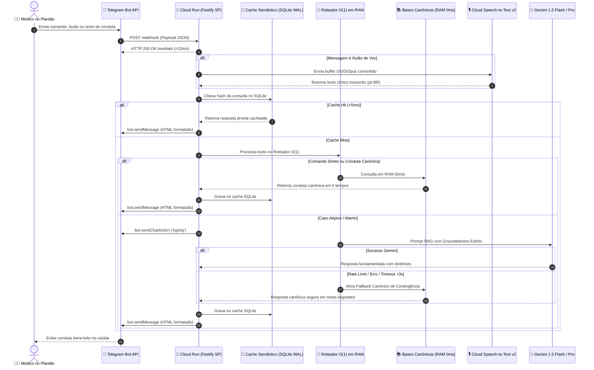

# 📘 Plano Mestre de Engenharia & Arquitetura Definitiva: Ultra Rotina

> **Documento Oficial de Engenharia e Tomada de Decisão Médica**  
> **Status**: Proposta Integral de Arquitetura & Backlog Cirúrgico (`/plan`)  
> **Meta Central**: Transformar o **Ultra Rotina** no mais rápido (<30ms em RAM), robusto e clinicamente confiável assistente médico beira-leito e bot do Telegram do Brasil, com resiliência total a falhas de rede/API, sustentabilidade financeira perpétua no Free Tier do Google Cloud Platform (GCP) e desenvolvimento acelerado no **Gemini Argon**.

---

## 1. Sumário Executivo & Metas Quantitativas de Engenharia

| Vetor de Engenharia | Métrica Atual | Meta Arquitetural Alvo | Como Será Atingido |
| :--- | :--- | :--- | :--- |
| **Latência Interna do Bot** | 150ms - 400ms | **< 30ms (p95 em RAM)** | Roteador de despacho $O(1)$ via Hash Map, eliminando cascata de Regex lineares. |
| **Latência de Rede (RTT)** | ~180ms (servidores fora) | **15ms - 25ms** | Hospedagem no Google Cloud Run em São Paulo (`southamerica-east1`). |
| **Confiabilidade Clínica** | Calculadoras isoladas | **100% Determinístico em 5 Tempos** | Catálogo canônico em RAM das 12 condutas críticas sem alucinação de LLM. |
| **Resiliência a Falhas de API** | Quebra se cota esgota | **Zero Downtime (Modo Degraded)** | Cascata: Gemini 1.5 Pro ➔ Gemini 1.5 Flash ➔ Motor Canônico Local em RAM. |
| **Entrada de Dados no Plantão** | Apenas digitação | **Voz para Texto Médica (<1.5s)** | Google Cloud Speech-to-Text v2 com vocabulário clínico brasileiro adaptado. |
| **Custo Pós-Créditos (30/11)** | Risco de cobrança | **R$ 0,00 / mês (Free Tier)** | Cloud Run serverless (escala a 0) + SQLite nativo embutido no contêiner. |

---

## 2. Topologia & Arquitetura do Sistema

### 2.1. Diagrama de Sequência: Ciclo de Vida da Mensagem no Telegram



---

### 2.2. Esquema do Banco de Dados Local (SQLite Nativo em Modo WAL)

No Node.js 24+, o SQLite é nativo (`node:sqlite`). A persistência é rápida e local no contêiner em `/app/data/rotina.db`:

```sql
-- Ativação de performance crítica
PRAGMA journal_mode = WAL;
PRAGMA synchronous = NORMAL;
PRAGMA busy_timeout = 5000;
PRAGMA foreign_keys = ON;

-- 1. Cache Semântico de Consultas Clínicas
CREATE TABLE IF NOT EXISTS cache_semantico (
    hash_consulta TEXT PRIMARY KEY,
    termo_original TEXT NOT NULL,
    resposta_html TEXT NOT NULL,
    categoria TEXT NOT NULL, -- 'conduta', 'calculadora', 'atb', 'remume'
    origem TEXT NOT NULL,    -- 'ram_canonico', 'gemini_flash', 'gemini_pro'
    hits_count INTEGER DEFAULT 1,
    criado_em DATETIME DEFAULT CURRENT_TIMESTAMP,
    expira_em DATETIME NOT NULL
);
CREATE INDEX IF NOT EXISTS idx_cache_expira ON cache_semantico(expira_em);

-- 2. Gestão de Leitos SBAR Beira-Leito
CREATE TABLE IF NOT EXISTS leitos_pacientes (
    id INTEGER PRIMARY KEY AUTOINCREMENT,
    numero_leito TEXT NOT NULL UNIQUE,
    iniciais_paciente TEXT,
    idade INTEGER,
    sexo TEXT CHECK(sexo IN ('M', 'F')),
    diagnostico_principal TEXT NOT NULL,
    situacao_atual TEXT NOT NULL,      -- S: Situação
    breve_historico TEXT,              -- B: Breve histórico / Comorbidades
    avaliacao_clinica TEXT NOT NULL,    -- A: Avaliação (DVA, VNI, Glasgow, Drogas)
    recomendacao_pendencias TEXT,      -- R: Recomendações / Exames pendentes
    alergias TEXT DEFAULT 'Nega alergias',
    clearance_estimado REAL,
    atualizado_em DATETIME DEFAULT CURRENT_TIMESTAMP
);

-- 3. Histórico e Métricas de Auditoria
CREATE TABLE IF NOT EXISTS telemetria_comandos (
    id INTEGER PRIMARY KEY AUTOINCREMENT,
    comando TEXT NOT NULL,
    latencia_ms REAL NOT NULL,
    sucesso INTEGER NOT NULL CHECK(sucesso IN (0, 1)),
    tipo_resposta TEXT NOT NULL, -- 'cache', 'ram', 'nuvem', 'fallback'
    executado_em DATETIME DEFAULT CURRENT_TIMESTAMP
);
```

---

## 3. Catálogo Cirúrgico das 12 Condutas Canônicas do Dia a Dia

Cada conduta abaixo está padronizada na **Estrutura Canônica em 5 Tempos** e codificada para execução direta em RAM em `src/02_condutas_dia_a_dia.js`:

---

### Conduta 1: Pico Hipertensivo / Pseudo-crise vs. Emergência Hipertensiva
* **Definição**: Elevação aguda de PA ($\text{PAS} \ge 180$ ou $\text{PAD} \ge 120\text{ mmHg}$).
* **⚡ 1. Conduta Imediata (minuto 0 ao 5)**: Avaliação física direcionada para Lesão de Órgão-Alvo (LOA): dor torácica, dispneia, déficit focal, alteração visual aguda, cefaleia em trovoada.
* **📋 2. Exames Indispensáveis**: Se sem LOA: nenhum exame de urgência necessário. Se suspeita de LOA: ECG de 12 derivações, Troponina, Ureia, Creatinina, Urina 1 e TC de crânio (se déficit).
* **💊 3. Prescrição Pronta**:
  * *Pseudo-crise (sem LOA)*: Repouso por 30-60 min em sala calma + Dipirona 1g VO (se dor) ou Clonazepam 0.25-0.5mg VO (se ansiedade franca). Ajustar anti-hipertensivo oral prévio de uso contínuo.
  * *Emergência com Edema Agudo de Pulmão*: Nitroglicerina IV (SG5% 240mL + Tridil 1 amp de 25mg/5mL = $100\text{ mcg/mL}$) iniciar a $10-20\text{ mcg/min}$ ($3-6\text{ mL/h}$) + Furosemida 40-80mg IV.
  * *Emergência com Dissecção de Aorta*: Esmolol ou Metoprolol IV antes do vasodilatador (alvo $\text{FC} < 60\text{ bpm}$ e $\text{PAS} < 120\text{ mmHg}$) + Nitroprussiato de Sódio.
* **🏥 4. Critérios de Decisão**: Sem LOA $\rightarrow$ Alta segura para UBS com reorientação; Com LOA $\rightarrow$ Vaga de Emergência/UTI com monitorização contínua e linha arterial invasiva.
* **⚠️ 5. Armadilhas ("O que NÃO fazer")**: **PROIBIDO Captopril sublingual ou Nifedipino de alívio rápido na pseudo-crise**. A queda brusca da PA causa hipoperfusão cerebral e coronariana, precipitando AVC isquêmico e infarto.

---

### Conduta 2: Febre no Paciente Internado
* **Definição**: Pico febril ($\text{Tax} \ge 37.8^\circ\text{C}$) em paciente internado em enfermaria clínica/cirúrgica.
* **⚡ 1. Conduta Imediata**: Checagem de sinais vitais e qSOFA (FR $\ge 22$, Glasgow $< 15$, PAS $\le 100$). Inspeção rápida de acessos vasculares, sítio cirúrgico, sondas e escaras.
* **📋 2. Exames Indispensáveis**: Coleta mandatória de **2 pares de Hemoculturas** de veias periféricas distintas (e 1 amostra de cateter se CVC com $>48$h) ANTES de qualquer novo antibiótico + Urina 1 e Urocultura + Raio-X de tórax.
* **💊 3. Prescrição Pronta**:
  * *Sintomático*: Dipirona 1g IV em 100mL SF 0,9% correr em 15 min se $\text{Tax} \ge 38.0^\circ\text{C}$ (intervalo 6/6h se necessário).
  * *Se Estável (sem disfunção orgânica)*: Manter vigilância clínica, colher culturas e aguardar resultado sem iniciar ATB empírico às cegas.
  * *Se Sinais de Sepse / Neutropenia Febril*: Cefepime 2g IV 8/8h (ou Piperacilina + Tazobactam 4.5g IV 6/6h) na primeira hora.
* **🏥 4. Critérios de Decisão**: Estável $\rightarrow$ Permanece em enfermaria com curva térmica de 4/4h; Hipotensão refratária a 1000mL cristalóide ou lactato $> 2\text{ mmol/L}$ $\rightarrow$ Acionar equipe de UTI.
* **⚠️ 5. Armadilhas ("O que NÃO fazer")**: Não iniciar antibiótico de largo espectro em paciente estável sem colher culturas prévias. Não usar AINEs (Cetoprofeno/Diclofenaco) em internados pelo alto risco de lesão renal aguda e sangramento digestivo.

---

### Conduta 3: Dor Torácica Aguda no Pronto-Socorro
* **Definição**: Dor ou desconforto precordial com suspeita de Síndrome Coronariana Aguda (SCA).
* **⚡ 1. Conduta Imediata**: Realizar e laudar **ECG de 12 derivações em até 10 minutos** da chegada do paciente (Porta-ECG $< 10$ min). Monitorização cardíaca contínua, oximetria e acesso venoso calibroso.
* **📋 2. Exames Indispensáveis**: Troponina ultrassensível (curva 0h/1h ou 0h/2h), Hemograma, Creatinina, Eletrólitos, Coagulograma e Raio-X de tórax no leito.
* **💊 3. Prescrição Pronta**:
  * *Dupla Antiagregação*: AAS 200 a 300mg VO mastigado (dose de ataque) + Ticagrelor 180mg VO ou Clopidogrel 300mg VO (600mg se cate imediato).
  * *Anticoagulação*: Enoxaparina 1mg/kg SC 12/12h (ajustar para 1mg/kg 1x/dia se $\text{CrCl} < 30\text{ mL/min}$; ou HNF IV se disfunção renal grave/cate iminente).
  * *Alívio da Dor*: Dinitrato de Isossorbida 5mg SL se dor persistente (desde que PAS $> 100$ e sem suspeita de infarto de ventrículo direito).
  * *Estatina de Alta Potência*: Atorvastatina 80mg VO à noite.
* **🏥 4. Critérios de Decisão**:
  * *Com Supra de ST*: Cate de urgência imediato (Porta-Balão $< 90$ min) ou Trombolítico se transferência $> 120$ min.
  * *Sem Supra de ST*: Estratificar pelo HEART Score: Baixo risco (0-3) $\rightarrow$ Protocolo de descarte; Moderado/Alto (4-10) $\rightarrow$ Internação em UTI coronariana / Hemodinâmica em 24h.
* **⚠️ 5. Armadilhas ("O que NÃO fazer")**: **Não administrar nitratos se suspeita de infarto de VD (derivações V3R e V4R) ou se o paciente fez uso de Sildenafil nas últimas 24h ou Tadalafil nas últimas 48h** (risco de choque refratário e morte). Não usar oxigênio de rotina se $\text{SpO}_2 \ge 90\%$ (hiperóxia causa vasoconstrição coronariana).

---

### Conduta 4: Insuficiência Cardíaca Aguda / Edema Agudo de Pulmão
* **Definição**: Descompensação aguda de IC com congestão sistêmica ou pulmonar.
* **⚡ 1. Conduta Imediata**: Classificar o paciente no perfil hemodinâmico de Stevenson:
  * **Perfil B (Quente e Úmido - 80% dos casos)**: Congestionado com boa perfusão periférica.
  * **Perfil C (Frio e Úmido)**: Congestionado com má perfusão / choque cardiogênico.
  * **Perfil L (Frio e Seco)**: Hipovolêmico / desidratado.
* **📋 2. Exames Indispensáveis**: ECG, Raio-X de tórax, Gasometria arterial/venosa, BNP ou NT-proBNP, Troponina, Ureia, Creatinina, Eletrólitos (Potássio e Sódio).
* **💊 3. Prescrição Pronta (Perfil B - Edema Agudo de Pulmão Hipertensivo)**:
  * *Ventilação Não Invasiva (VNI)*: CPAP com PEEP de 5 a 10 $\text{cmH}_2\text{O}$ ou BiPAP (IPAP 12-14 / EPAP 6-8) imediatamente.
  * *Diurético de Alça*: Furosemida 40 a 80mg IV em bólus (ou 2x a dose oral que o paciente toma em casa).
  * *Vasodilatador Venoso/Arterial*: Nitroglicerina IV a $10-20\text{ mcg/min}$ se PAS $> 110\text{ mmHg}$, titulando a cada 5 min.
* **🏥 4. Critérios de Decisão**: Alívio da congestão e gasometria estável $\rightarrow$ Enfermaria cardiológica; Refratariedade, acidose respiratória persistente ou necessidade de inotrópico (Perfil C com Dobutamina) $\rightarrow$ UTI cardiológica.
* **⚠️ 5. Armadilhas ("O que NÃO fazer")**: Não usar betabloqueador na fase de descompensação aguda com congestão ativa. Não atrasar o início da VNI (ela reduz em até 50% a necessidade de intubação orotraqueal e mortalidade).

---

### Conduta 5: Pneumonia Adquirida na Comunidade (PAC)
* **Definição**: Infecção aguda do parênquima pulmonar adquirida fora do ambiente hospitalar.
* **⚡ 1. Conduta Imediata**: Calcular o escore **CURB-65**:
  * **C**onfusão mental (1 pt)
  * **U**reia $> 50\text{ mg/dL}$ (1 pt)
  * **R**espiração: $\text{FR} \ge 30\text{ irpm}$ (1 pt)
  * **B**lood Pressure: $\text{PAS} < 90$ ou $\text{PAD} \le 60\text{ mmHg}$ (1 pt)
  * **65**: Idade $\ge 65$ anos (1 pt)
* **📋 2. Exames Indispensáveis**: Raio-X de tórax em PA e perfil. Se CURB-65 $\ge 2$: Ureia, Creatinina, Hemograma, PCR e 2 pares de hemoculturas.
* **💊 3. Prescrição Pronta**:
  * *Ambulatorial (CURB-65 = 0 ou 1, sem comorbidades)*: Amoxicilina 500mg VO 8/8h por 5 a 7 dias (ou Azitromicina 500mg VO 1x/dia por 5 dias se alergia leve).
  * *Ambulatorial (idoso ou comorbidades)*: Amoxicilina + Clavulanato 875/125mg VO 12/12h + Azitromicina 500mg VO 1x/dia por 5 dias.
  * *Internação Enfermaria (CURB-65 = 2)*: Ceftriaxona 1g a 2g IV 1x/dia + Azitromicina 500mg VO/IV 1x/dia por 5 a 7 dias.
  * *Internação UTI (CURB-65 $\ge 3$)*: Ceftriaxona 2g IV 1x/dia + Levofloxacino 750mg IV 1x/dia (ou Claritromicina 500mg IV 12/12h).
* **🏥 4. Critérios de Decisão**: Escore 0-1 $\rightarrow$ Domicílio com orientações; Escore 2 $\rightarrow$ Enfermaria; Escore 3-5 $\rightarrow$ Considerar UTI.
* **⚠️ 5. Armadilhas ("O que NÃO fazer")**: Não prescrever quinolonas respiratórias (Levofloxacino/Moxifloxacino) no ambulatório para casos leves sem indicação restrita (risco de indução de resistência e tendinite/ruptura do tendão de Aquiles).

---

### Conduta 6: Sepse e Choque Séptico (Protocolo da 1ª Hora)
* **Definição**: Disfunção orgânica potencialmente fatal causada por resposta desregulada do hospedeiro à infecção (aumento de $\ge 2$ pontos no SOFA).
* **⚡ 1. Conduta Imediata (O Bundle da 1ª Hora)**:
  1. Dosar **Lactato sérico** imediatamente.
  2. Colher **Hemoculturas (2 pares)** antes de administrar antimicrobianos.
  3. Iniciar **Antibiótico de amplo espectro** em até 60 minutos da suspeita.
  4. Iniciar **Ressuscitação volêmica rápida com $30\text{ mL/kg}$ de cristaloide balanceado** (Ringer Lactato) se PAS $< 90$, PAM $< 65$ ou Lactato $\ge 4\text{ mmol/L}$.
  5. Iniciar **Vasopressor precoce (Noradrenalina)** se PAM $< 65\text{ mmHg}$ refratária durante a infusão de volume.
* **📋 2. Exames Indispensáveis**: Gasometria arterial com lactato, Hemograma, Bilirrubinas, Coagulograma (INR/Plaquetas), Creatinina, Eletrólitos e Urina 1.
* **💊 3. Prescrição Pronta de Drogas Vasoativas**:
  * *Noradrenalina*: SG5% 234mL + 4 ampolas de Noradrenalina (4mg/4mL = 16mg) $\rightarrow$ Concentração: $64\text{ mcg/mL}$.
  * *Dose*: Iniciar a $0.05\text{ a }0.1\text{ mcg/kg/min}$ ($3-7\text{ mL/h}$ em paciente de 70kg), titulando a cada 3-5 min para alvo de $\text{PAM} \ge 65\text{ mmHg}$.
  * *Vasopressina*: Se dose de Noradrenalina $> 0.25\text{ mcg/kg/min}$, associar Vasopressina em dose fixa de $0.03\text{ UI/min}$ em bomba dedicada.
* **🏥 4. Critérios de Decisão**: Qualquer critério de choque séptico exige leito de **UTI com prioridade máxima**.
* **⚠️ 5. Armadilhas ("O que NÃO fazer")**: Não usar Soro Fisiológico 0,9% em grandes volumes ($> 2-3\text{L}$) pelo alto risco de acidose metabólica hiperclorêmica e lesão renal aguda. Não aguardar o término dos $30\text{ mL/kg}$ para iniciar Noradrenalina se o paciente estiver profundamente hipotenso.

---

### Conduta 7: Cólica Nefrética Aguda
* **Definição**: Dor lombar súbita, em cólica, de forte intensidade, com irradiação para flanco, fossa ilíaca ou genitália.
* **⚡ 1. Conduta Imediata**: Alívio imediato da dor e triagem de sinais de sepse urinária obstrutiva (febre, calafrios, hipotensão).
* **📋 2. Exames Indispensáveis**: Urina 1 (hematúria/leucocitúria), Ureia e Creatinina. Tomografia Computadorizada de Abdome/Pelve sem contraste (padrão-ouro) ou USG de vias urinárias (gestantes e jovens).
* **💊 3. Prescrição Pronta**:
  * *1ª Linha (Anti-inflamatório IV)*: Cetoprofeno 100mg IV diluído em 100mL SF 0,9% correr em 20 min (OU Tenoxicam 40mg IV).
  * *Adjuvante*: Dipirona 1g a 2g IV lenta.
  * *Resgate de Dor Refratária*: Morfina 2 a 4mg IV diluída em 9mL SF lenta a cada 15 min se dor persistir após AINE.
  * *Terapia Expulsiva Ambulatorial (cálculo de 5 a 10 mm no ureter distal)*: Tansulosina 0.4mg VO 1x/dia após o jantar por até 4 semanas.
* **🏥 4. Critérios de Decisão**:
  * *Alta*: Dor controlada, cálculo $< 5\text{ mm}$, função renal normal e ausência de febre.
  * *Internação / Avaliação Urológica Urgente*: Cálculo obstrutivo com febre/sepse (urgência cirúrgica para desobstrução com Duplo J ou Nefrostomia), rim único, anúria ou dor refratária.
* **⚠️ 5. Armadilhas ("O que NÃO fazer")**: **Não hiper-hidratar o paciente com soro na fase aguda** (aumento do débito urinário sobre um ureter obstruído distende a cápsula renal e piora violentamente a dor). AINEs são mais eficazes que opioides na cólica nefrética porque reduzem a síntese de prostaglandinas e o espasmo ureteral.

---

### Conduta 8: Cefaleia Aguda na Emergência & Triagem SNOOP
* **Definição**: Cefaleia aguda no pronto-socorro exigindo exclusão de causas secundárias com risco de morte.
* **⚡ 1. Conduta Imediata**: Checar a regra dos **Red Flags (SNOOP)**:
  * **S**intomas sistêmicos / Febre / Perda de peso / Câncer / HIV.
  * **N**eurológico: Déficit focal, rebaixamento de consciência, papiledema.
  * **O**nset súbito: Cefaleia em trovoada (*thunderclap* - atinge pico em $< 1$ minuto, suspeita de HSA).
  * **O**lder: Início após os 50 anos (suspeita de arterite de células gigantes / lesão expansiva).
  * **P**adrão modificado: Mudança do padrão crônico ou precipitada por manobra de Valsalva/postura.
* **📋 2. Exames Indispensáveis**: Se SNOOP positivo: **TC de crânio sem contraste de urgência**. Se suspeita de Hemorragia Subaracnóidea e TC normal em até 6h: Punção lombar para pesquisa de xantocromia e líquor.
* **💊 3. Prescrição Pronta (Crise de Enxaqueca / Cefaleia Primária sem Red Flags)**:
  * *Dipirona*: 1g a 2g IV diluída em 100mL SF 0,9%.
  * *AINE*: Cetoprofeno 100mg IV em 100mL SF.
  * *Antiemético/Neuroléptico*: Metoclopramida 10mg IV ou Clorpromazina 12.5 a 25mg IV lenta diluída em 100mL SF (excelente efeito abortivo).
  * *Prevenção de Recorrência*: Dexametasona 10mg IV dose única.
* **🏥 4. Critérios de Decisão**: SNOOP negativo e alívio completo da dor $\rightarrow$ Alta com orientações; SNOOP positivo $\rightarrow$ Internação para propedêutica armada.
* **⚠️ 5. Armadilhas ("O que NÃO fazer")**: **NÃO usar opioides (Tramadol, Morfina) no manejo da enxaqueca**. Opioides aumentam náuseas, causam dependência, cronificação da dor e efeito rebote refratário.

---

### Conduta 9: Hipoglicemia e Cetoacidose Diabética (CAD)
* **Definição**: Emergências do metabolismo da glicose no diabetes.
* **⚡ 1. Conduta Imediata**:
  * *Hipoglicemia ($\text{Glicemia} < 70\text{ mg/dL}$)*:
    * Se consciente: **Regra dos 15**: ingerir 15g de carboidrato de absorção rápida (1 colher de sopa de açúcar ou 150mL de suco/refrigerante comum). Reavaliar glicemia capilar em 15 minutos.
    * Se inconsciente / sem via oral: **Glicose 50% 4 a 8 ampolas (20 a 40g) IV em bólus direto**. Se persistir inconsciente após normalizar glicemia: investigar edema cerebral.
  * *Cetoacidose Diabética (CAD)*:
    * Hidratação com SF 0,9% 1000 mL na primeira hora.
    * **REGRA DE OURO DO POTÁSSIO**: Dosar Potássio sérico ANTES de iniciar insulina!
      * Se $\text{K}^+ < 3.3\text{ mEq/L}$: **PROIBIDO INICIAR INSULINA**. Repor KCl 20 a 30 mEq/h até $\text{K}^+ \ge 3.3$ (risco de parada cardiorrespiratória em assistolia/FV!).
      * Se $\text{K}^+ \ge 3.3\text{ a }5.2\text{ mEq/L}$: Iniciar Insulina Regular 0.1 UI/kg/h em BIC + 20-30 mEq de KCl por litro de soro.
* **📋 2. Exames Indispensáveis na CAD**: Gasometria arterial/venosa, Glicemia, Ureia, Creatinina, Sódio, Potássio, Cloreto (para cálculo do Anion Gap) e Cetonúria/Cetonemia.
* **🏥 4. Critérios de Decisão**: Hipoglicemia por sulfonilureia $\rightarrow$ Internação mínima de 24h (risco de hipoglicemia tardia prolongada); CAD $\rightarrow$ Internação mandatória em UTI ou sala de emergência.
* **⚠️ 5. Armadilhas ("O que NÃO fazer")**: Não desligar a bomba de insulina quando a glicemia atingir $200-250\text{ mg/dL}$. A conduta correta é associar Soro Glicosado a 5% ou 10% para manter a glicemia entre 150-200 mg/dL e continuar a insulina até a resolução completa da acidose e fechamento do Anion Gap.

---

### Conduta 10: Agitação Psicomotora e Delirium no Paciente Internado
* **Definição**: Alteração aguda e flutuante da atenção e cognição, comum em idosos internados.
* **⚡ 1. Conduta Imediata**: Investigar e tratar a causa base descompensadora: infecção oculta (ITU/pneumonia), retenção urinária aguda ("globo vesical"), fecaloma, dor não comunicada, distúrbio hidroeletrolítico ou abstinência.
* **📋 2. Medidas Não Farmacológicas (1ª Linha)**: Iluminação condizente com o ciclo circadiano, presença de familiar no quarto, relógio e calendário visíveis, manter óculos e aparelhos auditivos, evitar contenção física desnecessária.
* **💊 3. Prescrição Farmacológica (Apenas se risco de auto/heteroagressão ou perda de CVC/IOT)**:
  * *Haloperidol*: 1 a 2.5mg VO ou IM (dose menor em idosos: 0.5 a 1mg). Repetir após 30-60 min se necessário (máximo 5-10mg/dia).
  * *Alternativa Atípica*: Risperidona 0.5 a 1mg VO ou Quetiapina 25 a 50mg VO à noite.
* **🏥 4. Critérios de Decisão**: Manejo em enfermaria com acompanhante; solicitar parecer de Psiquiatria/Geriatria se refratariedade.
* **⚠️ 5. Armadilhas ("O que NÃO fazer")**: **PROIBIDO BENZODIAZEPÍNICOS (Diazepam, Clonazepam, Midazolam) no delirium do idoso**. Os benzodiazepínicos causam sedação excessiva, pioram a confusão mental, precipitam efeito paradoxal de agitação e aumentam a mortalidade (exceção única: delirium tremens por abstinência alcoólica).

---

### Conduta 11: Erisipela vs. Celulite
* **Definição**: Infecções agudas de pele e subcutâneo. Erisipela (placa eritematosa bem delimitada, acometimento superficial/derme, estreptocócica). Celulite (eritema com bordos mal definidos, tecido celular subcutâneo profundo, estafilocócica/estreptocócica).
* **⚡ 1. Conduta Imediata**: Delimitar o bordo do eritema com caneta para monitorar evolução e resposta terapêutica nas próximas 24-48 horas. Investigar porta de entrada (tinea pedis, úlcera, picada, trauma).
* **📋 2. Exames Indispensáveis**: Casos leves ambulatoriais não necessitam de exames. Casos com sinais sistêmicos: Hemograma, PCR, Ureia, Creatinina e glicemia.
* **💊 3. Prescrição Pronta**:
  * *Ambulatorial / Leve (Erisipela ou Celulite não complicada)*:
    * Cefalexina 500mg VO 6/6h por 7 a 10 dias.
    * Alternativa (alergia a penicilina): Clindamicina 300mg VO 8/8h ou Sulfametoxazol + Trimetoprima 800/160mg 12/12h.
    * Medida adjunta: Elevação do membro afetado durante o repouso (fundamental para drenagem linfática).
  * *Hospitalar / Moderada a Grave (sinais de sepse, progressão rápida, comorbidades descompensadas)*:
    * Oxacilina 2g IV 4/4h OU Cefazolina 1g a 2g IV 8/8h.
* **🏥 4. Critérios de Decisão**: Sem sinais sistêmicos $\rightarrow$ Tratamento ambulatorial com reavaliação em 48h; Febre alta, bolhas hemorrágicas, hipotensão, crepitação ou dor desproporcional (suspeita de fasceíte necrotizante) $\rightarrow$ Internação imediata com avaliação da Cirurgia Geral para desbridamento.
* **⚠️ 5. Armadilhas ("O que NÃO fazer")**: Não esquecer de tratar a tinea pedis interdigital ("frieira"), que é a principal porta de entrada e causa de erisipela de repetição. Não atrasar o desbridamento cirúrgico se houver sinais de infecção necrotizante.

---

### Conduta 12: Hemorragia Digestiva Alta (HDA)
* **Definição**: Sangramento do trato gastrointestinal proximal ao ângulo de Treitz (hematêmese, melena ou enterorragia volumosa).
* **⚡ 1. Conduta Imediata**: Obter 2 acessos venosos calibrosos (14G ou 16G). Iniciar ressuscitação com Ringer Lactato. Tipagem sanguínea e prova cruzada (reservar 2 a 4 concentrados de hemácias). Alvo de hemoglobina: $\text{Hb} \ge 7-8\text{ g/dL}$ (estratégia transfusional restritiva).
* **📋 2. Exames Indispensáveis**: Hemograma seriado, Coagulograma, Ureia, Creatinina, Eletrólitos e Provas de função hepática. **Endoscopia Digestiva Alta (EDA) nas primeiras 24 horas** (após estabilização hemodinâmica).
* **💊 3. Prescrição Pronta**:
  * *Inibidor de Bomba de Prótons (IBP)*: Omeprazol 80mg IV em bólus + 8mg/h em BIC por 72h (OU 40mg IV 12/12h).
  * *Se Suspeita de Doença Varicosa (Cirrose / Hipertensão Portal)*:
    * **Terlipressina**: 2mg IV em bólus inicial, seguido de 1 a 2mg IV a cada 4 horas por 2 a 5 dias.
    * **Ceftriaxona**: 1g IV 1x/dia por 7 dias (profilaxia antimicrobiana mandatória de Peritonite Bacteriana Espontânea, reduz mortalidade).
* **🏥 4. Critérios de Decisão**: Instabilidade hemodinâmica, necessidade de drogas vasoativas ou sangramento varicoso ativo $\rightarrow$ Internação mandatória em UTI.
* **⚠️ 5. Armadilhas ("O que NÃO fazer")**: Não hipertransfundir o paciente cirrótico ($\text{Hb} > 9\text{ g/dL}$ aumenta a pressão no sistema porta e causa ressangramento varicoso maciço). Não esquecer o antibiótico profilático (Ceftriaxona) em cirróticos com HDA.

---

## 4. Pipeline de Áudio & Voz Médica (Cloud Speech-to-Text v2 & Cloud TTS)

### 4.1. Speech-to-Text v2: Adaptação de Vocabulário Médico Brasileiro
O módulo `server/speech_to_text.js` utiliza a API v2 configurada com `PhraseSet` médico em `pt-BR`:

```javascript
const { SpeechClient } = require('@google-cloud/speech').v2;
const client = new SpeechClient();

const VOCABULARIO_MEDICO_BR = [
  'TFG', 'clearance', 'creatinina', 'gasometria', 'lactato', 'acidose', 'alcalose',
  'pCO2', 'pO2', 'bicarbonato', 'anion gap', 'noradrenalina', 'vasopressina',
  'dobutamina', 'fentanil', 'midazolam', 'cetamina', 'etomidato', 'rocuronio',
  'succinilcolina', 'SBAR', 'CURB-65', 'HEART score', 'cefepime', 'meropenem',
  'ceftriaxona', 'vancomicina', 'piperacilina', 'tazobactam', 'enoxaparina',
  'fibrilacao atrial', 'supra de ST', 'edema agudo de pulmao', 'Stevenson',
  'Glasgow', 'Blumberg', 'Murphy', 'Rovsing', 'colica nefretica', 'delirium'
];
```

---

## 5. Infraestrutura & Deploy no Google Cloud Platform

### 5.1. Provisionamento Automatizado via CLI (`gcloud`)

Execute os comandos abaixo na máquina local:

```bash
# 1. Configurar variáveis de ambiente
export PROJECT_ID="ultra-rotina-prod"
export REGION="southamerica-east1"

# 2. Criar projeto e vincular billing
gcloud projects create $PROJECT_ID --name="Ultra Rotina Producao"
gcloud config set project $PROJECT_ID
# Vincule ao seu Billing Account ID de R$ 1.700:
# gcloud billing projects link $PROJECT_ID --billing-account=SEU_ID

# 3. Habilitar APIs necessárias
gcloud services enable \
  run.googleapis.com \
  cloudbuild.googleapis.com \
  artifactregistry.googleapis.com \
  cloudscheduler.googleapis.com \
  speech.googleapis.com \
  texttospeech.googleapis.com \
  storage.googleapis.com

# 4. Criar Service Account com privilégios mínimos
gcloud iam service-accounts create rotina-sa \
  --display-name="Ultra Rotina Service Account"

gcloud projects add-iam-policy-binding $PROJECT_ID \
  --member="serviceAccount:rotina-sa@${PROJECT_ID}.iam.gserviceaccount.com" \
  --role="roles/speech.client"

gcloud projects add-iam-policy-binding $PROJECT_ID \
  --member="serviceAccount:rotina-sa@${PROJECT_ID}.iam.gserviceaccount.com" \
  --role="roles/storage.objectAdmin"

# 5. Criar repositório Docker no Artifact Registry em São Paulo
gcloud artifacts repositories create rotina-docker \
  --repository-format=docker \
  --location=$REGION \
  --description="Imagens de Producao do Ultra Rotina"

# 6. Deploy no Cloud Run (Serverless com Free Tier Perpétuo)
gcloud run deploy ultra-rotina-server \
  --source="." \
  --region=$REGION \
  --platform=managed \
  --allow-unauthenticated \
  --memory=512Mi \
  --cpu=1 \
  --min-instances=0 \
  --max-instances=2 \
  --concurrency=80 \
  --service-account="rotina-sa@${PROJECT_ID}.iam.gserviceaccount.com" \
  --set-env-vars="NODE_ENV=production,PORT=8080"
```

---

### 5.2. Cloud Scheduler (Disparos Autônomos de Rotina)

Configuração dos gatilhos pontuais HTTP para que o Cloud Run escale a 0 e não gaste CPU em repouso:

```bash
# Briefing Clínico Matinal (06:15 de segunda a sexta)
gcloud scheduler jobs create http briefing-matinal \
  --schedule="15 6 * * 1-5" \
  --time-zone="America/Sao_Paulo" \
  --uri="https://ultra-rotina-server-xyz-rj.a.run.app/api/rotina/ciclo" \
  --http-method=POST \
  --message-body='{"acao":"briefing_matinal"}'

# Check-in Noturno e Hábitos (21:30 todos os dias)
gcloud scheduler jobs create http checkin-noturno \
  --schedule="30 21 * * *" \
  --time-zone="America/Sao_Paulo" \
  --uri="https://ultra-rotina-server-xyz-rj.a.run.app/api/rotina/ciclo" \
  --http-method=POST \
  --message-body='{"acao":"checkin_noturno"}'
```

---

## 6. Bateria de Prompts Mestres para o Gemini Argon (Web)

Copie e cole estes prompts diretamente no site do Gemini com o modelo **Gemini Argon**:

---

### 📝 Prompt 1: Roteador O(1) com Fila Assíncrona no Telegram
```text
Você é um Engenheiro de Software Sênior especialista em Node.js e Telegram Bot API de altíssima performance.
Estou refatorando o arquivo `src/07a_telegram_router.js` do projeto "Ultra Rotina".

OBJETIVO:
Substituir a cascata de avaliações Regex lineares por um roteador de despacho O(1) baseado em Map estático, com resposta assíncrona de 2 fases no Telegram para evitar timeouts.

REQUISITOS TÉCNICOS:
1. Criar o mapa estático `COMANDOS_RAPIDOS = new Map()` mapeando os comandos diretos:
   - Condutas: '/conduta', '/pa', '/febre', '/dortoracica', '/dispneia', '/sepse', '/colica', '/delirium'
   - Calculadoras: '/crcl', '/gaso', '/dva', '/sri', '/pcr', '/dhe', '/curb65', '/heart'
   - Antimicrobianos: '/atb', '/remume', '/interacoes'
   - Plantão: '/leitos', '/leito', '/passagem', '/rotina'
2. Extração atômica de comando e argumentos via String.prototype.indexOf(' ') e slice:
   Ex: '/crcl 70 1.2 M 65' -> cmd: '/crcl', args: ['70', '1.2', 'M', '65'].
3. Se o comando existir no Map: executar imediatamente o handler em RAM (<1ms).
4. Se a consulta for aberta/atípica ou exigir chamada de IA:
   - Enviar imediatamente `bot.sendChatAction(chatId, 'typing')`.
   - Executar a consulta com a classe `OrquestradorIAResiliente`.
5. Tratamento de mensagens de voz: se `msg.voice` estiver presente, chamar o módulo `server/speech_to_text.js` e reintroduzir o texto transcrito no pipeline.

Forneça o código limpo, modular e de alta velocidade para `src/07a_telegram_router.js`.
```

---

### 📝 Prompt 2: Módulo Canônico das 12 Condutas do Dia a Dia (`src/02_condutas_dia_a_dia.js`)
```text
Você é um Preceptor Chefe de Emergência Clínica e Clínica Médica (R1-USP) e Desenvolvedor Node.js.
Estou implementando o núcleo canônico de tomada de decisão médica do projeto "Ultra Rotina".

OBJETIVO:
Criar o arquivo `src/02_condutas_dia_a_dia.js` contendo as 12 condutas canônicas prioritárias de beira-leito organizadas estritamente na estrutura em 5 tempos:
1. Conduta Imediata (minuto 0 ao 5)
2. Exames Indispensáveis
3. Prescrição Pronta (Fármacos, doses de ataque/manutenção, diluições ISMP, vias e intervalos)
4. Critérios de Decisão (Internar / UTI vs Alta Segura)
5. Sinais de Alarme & Armadilhas ("O que NÃO fazer")

CONTEÚDO CLÍNICO OBRIGATÓRIO:
1. Pico Hipertensivo / Pseudo-crise vs Emergência (bloqueio estrito de Captopril SL na pseudo-crise)
2. Febre no Internado (coleta de 2 pares de hemoculturas antes de qualquer novo ATB)
3. Dor Torácica / IAM (protocolo 10 minutos porta-ECG, HEART score, DAPT e enoxaparina)
4. Insuficiência Cardíaca Aguda / EAP (perfis de Stevenson, VNI precoce, nitrato e furosemida)
5. PAC (CURB-65 e esquema amoxicilina/azitro vs ceftriaxona)
6. Sepse e Choque Séptico (bundle da 1ª hora, 30 mL/kg cristaloide balanceado e noradrenalina precoce)
7. Cólica Nefrética (AINE intravenoso como 1ª linha superior a opioides; tansulosina)
8. Cefaleia Aguda na Emergência (Red Flags SNOOP, TC/PL na HSA; manejo de enxaqueca sem opioides)
9. Hipoglicemia e CAD (regra dos 15; reposição de potássio mandatória antes de insulina regular em BIC)
10. Delirium no Idoso Internado (medidas não farmacológicas; haloperidol baixo; PROIBIDO benzodiazepínicos)
11. Erisipela vs Celulite (cefalexina ambulatorial vs oxacilina/cefazolina internado; elevar membro)
12. HDA (estabilização, omeprazol em BIC, terlipressina e ceftriaxona em cirróticos; EDA em 24h)

Forneça o arquivo completo `src/02_condutas_dia_a_dia.js` com a função de busca por sinônimos `buscarConduta(termo)` e a função de renderização `formatarCondutaHTML(conduta)`.
```

---

### 📝 Prompt 3: Orquestrador de Cascata Resiliente & Cache Semântico (`src/04_motores_ia.js`)
```text
Você é um Arquiteto de Software Backend Node.js especialista em Resiliência e IA Generativa.
Estou implementando a blindagem de chamadas de IA do projeto "Ultra Rotina".

OBJETIVO:
Refatorar `src/04_motores_ia.js` implementando uma classe `OrquestradorIAResiliente` com:
1. Cache Semântico em SQLite WAL (`cache_semantico`): verifica hash da dúvida normalizada antes de qualquer chamada externa.
2. Cascata Multi-Modelo (Circuit Breaker):
   - 1º: Vertex AI / Gemini 1.5 Pro (timeout de 3.5 segundos).
   - 2º: Gemini 1.5 Flash (fallback imediato em caso de erro, rate-limit 429 ou timeout).
   - 3º: Fallback Canônico Determinístico em RAM (`src/04_ia_local_fallback.js` e `src/02_condutas_dia_a_dia.js`) se todas as APIs falharem.
3. System Prompt de Groundedness Rígido: Proibir alucinações; citar consensos brasileiros (SBC, SBPT, SBD, AMIB, FEBRASGO, MS); formatação em HTML seguro do Telegram.

Forneça o arquivo `src/04_motores_ia.js` completo e pronto para produção.
```

---

### 📝 Prompt 4: Módulo de Transcrição Médica de Voz (`server/speech_to_text.js`)
```text
Você é um Especialista em Google Cloud Platform e Engenharia de Áudio em Node.js.
Estou implementando o processamento de voz clínica no "Ultra Rotina".

OBJETIVO:
Criar o módulo `server/speech_to_text.js` utilizando a API Google Cloud Speech-to-Text v2.

REQUISITOS:
1. Receber buffer de áudio OGG/Opus do Telegram.
2. Converter para WAV Linear16 mono 16kHz em memória usando stream (ou ffmpeg).
3. Chamar a API Speech-to-Text v2 com:
   - Idioma: 'pt-BR'.
   - Modelo: 'medical_conversation' ou 'latest_long'.
   - PhraseSet de adaptação contendo termos médicos (TFG, clearance, creatinina, gasometria, lactato, noradrenalina, vasopressina, SRI, etomidato, rocuronio, SBAR, Glasgow, Blumberg).
4. Retornar a string limpa transcrita para o roteador de comandos.
5. Fallback gracioso com timeout de 6 segundos.

Forneça o arquivo `server/speech_to_text.js` completo.
```

---

### 📝 Prompt 5: Calculadora Expressa de SRI em 1 Toque (`src/07d_telegram_callbacks.js`)
```text
Você é um Médico Emergencista e Desenvolvedor Node.js.
Estou criando a calculadora de Sequência Rápida de Intubação (SRI) mais rápida do mercado para o Telegram Bot do "Ultra Rotina".

OBJETIVO:
Quando o usuário digitar `/sri`, o bot envia um teclado inline com botões táteis de peso:
[ 50 kg ] [ 60 kg ] [ 70 kg ] [ 80 kg ] [ 90 kg ] [ 100 kg ]

Ao tocar no botão de peso, a mensagem é editada instantaneamente com:
1. Preparação & Pré-oxigenação (alvo SpO2 > 93%).
2. Pré-medicação: Lidocaína 1.5 mg/kg (em TCE/HIC) ou Fentanil 2-3 mcg/kg (em emergência hipertensiva/dissecção).
3. Indução:
   - Etomidato 0.3 mg/kg (dose em mg e volume em mL na apresentação comercial de 2mg/mL).
   - OU Cetamina 1.5 a 2.0 mg/kg (dose em mg e volume em mL na apresentação comercial de 50mg/mL).
4. Bloqueio Neuromuscular:
   - Succinilcolina 1.5 mg/kg (dose em mg e volume em mL na apresentação de 100mg/10mL = 10mg/mL).
   - OU Rocurônio 1.2 mg/kg (dose em mg e volume em mL na apresentação de 50mg/5mL = 10mg/mL).
5. Tamanho de tubo orotraqueal e fixação preditos.

Forneça as funções de geração de teclado e o handler de callback em `src/07d_telegram_callbacks.js`.
```

---

### 📝 Prompt 6: Guia Antimicrobiano com Ajuste Renal Automático (`src/07c_telegram_consultas_e_ia.js`)
```text
Você é um Farmacologista Clínico e Desenvolvedor Node.js.
Estou expandindo o comando `/atb` do "Ultra Rotina".

OBJETIVO:
Criar uma base de consulta em memória RAM com os principais antibióticos de enfermaria e PS, fornecendo:
1. Posologia padrão em adultos.
2. Tabela de ajuste obrigatório por faixa de clearance renal (TFG / Cockcroft-Gault):
   - TFG > 50 mL/min (dose plena)
   - TFG 30 a 50 mL/min
   - TFG 10 a 29 mL/min
   - TFG < 10 mL/min e Hemodiálise (dose complementar pós-diálise)
3. Fármacos: Meropenem, Ceftriaxona, Cefepime, Ciprofloxacino, Piperacilina+Tazobactam, Vancomicina, Amoxicilina+Clavulanato, Sulfametoxazol+Trimetoprima.
4. Avisos críticos de toxicidade (neurotoxicidade do cefepime, nefrotoxicidade da vancomicina).

Forneça a estrutura de dados JSON em RAM e a função de busca/formatação em HTML para `src/07c_telegram_consultas_e_ia.js`.
```

---

## 7. Plano de Verificação, Testes & Métricas de Aceite

Execute a bateria completa de homologação:

```bash
# 1. Executar bateria oficial de testes unitários
npm test

# 2. Testar bundle compilado de produção
npm run build

# 3. Teste de latência local com Fastify
node server.js &
PID=$!
sleep 2

# Simular consulta ao /health e /webhook
curl -s -w "\nTempo de Resposta: %{time_total}s\n" http://localhost:10000/health

kill $PID
```
