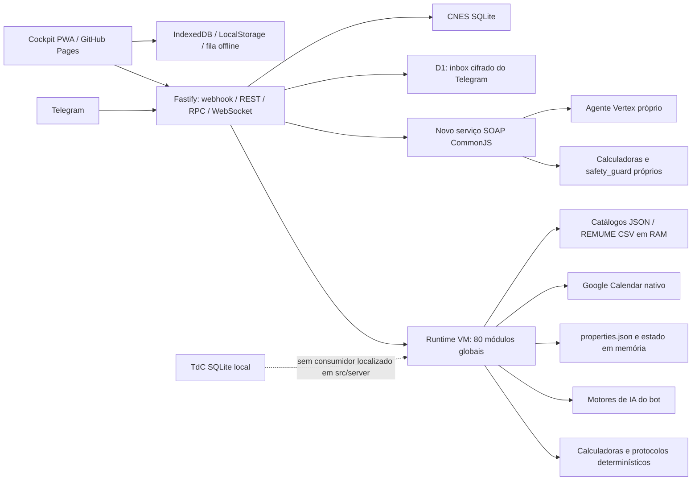

# Auditoria integral do Rotina — 17/10/2026

## Parecer

O Rotina possui um núcleo clínico amplo, cálculos determinísticos úteis e mecanismos reais de recuperação de mensagens. Entretanto, o estado auditado **precisa de correções antes de ser considerado seguro e integrado para uso clínico**. Os problemas mais importantes estão nas fronteiras: autorização HTTP, preservação do estado, contratos entre interfaces e serviços, validade dos catálogos e apresentação das salvaguardas clínicas.

A ampliação funcional avançou mais rápido que a integração. Há funcionalidades implementadas isoladamente, testes verdes sobre partes delas e documentação declarando conclusão, embora o percurso completo ainda descarte dados ou use outro serviço.

Foram consolidados **22 grupos de achados: 15 de prioridade alta (P1), 7 de prioridade média (P2)**, sem apontamentos cosméticos. Os eixos de engenharia, clínica e requisitos permanecem separados. P1 significa correção prioritária antes de ampliar a exposição/uso do caminho afetado; não significa que houve exploração ou dano em produção. Não há fundamento para exigir uma reescrita total: preservar o núcleo determinístico e corrigir fronteiras é uma estratégia mais verificável.

## Escopo, método e limitações

- Revisão do estado completo disponível, incluindo mudanças não commitadas; não apenas do último diff. HEAD inicial: `2f16de1`.
- Inspeção de `server/`, runtime, módulos de `src/`, novo `src/clinical/`, IA, catálogos, SQLite, Cockpit, Rotina, Calendar, Telegram, persistência, build, deploy e testes. Aprofundamento orientado a risco; não é certificação individual de todas as fórmulas e protocolos.
- Skills aplicadas: `code-review` adaptada ao snapshot completo pedido pelo usuário, `clean-code-guard` em modo revisão, `andrej-karpathy`, `systematic-debugging`, `self-improving-agent` e `verification-before-completion`. Dois revisores independentes examinaram engenharia e requisitos; o revisor principal examinou clínica, testes e evidências.
- Fontes de requisitos: `AGENTS.md`, `README.md`, `PROGRESS.md`, contratos e interfaces do próprio projeto. Nenhuma criação ou alteração de GAS.
- Reproduções com dados sintéticos; HTTP local via `Fastify.inject`, funções puras e VM do frontend. Sem enviar mensagens, alterar agenda real, consultar prontuários ou chamar modelos pagos. A bateria utiliza o runner do projeto; sua ressalva sobre cópia de credenciais está documentada adiante.
- Não inspecionados: configuração efetiva do Render, tráfego real, IAM, backups/restauração remotos, disponibilidade de cada modelo na conta, latência de produção, renderização visual em navegador e qualidade das respostas de modelos reais. Exposição externa das vulnerabilidades depende do código/configuração publicados.
- O diretório mudou durante a bateria global. Foram identificadas diferenças em `src/07a_telegram_router.js`, `src/04_ia_local_fallback.js` e `src/07c_telegram_consultas_e_ia.js` em relação ao snapshot independente inicial. Os revisores não editaram esses arquivos. Linhas são referências do estado observado e devem ser reconferidas antes da correção.

## Visão geral da arquitetura

O D1 não é o banco geral do aplicativo: armazena a caixa de entrada cifrada do Telegram. Rotina e outros estados continuam dependendo do armazenamento local de propriedades. O CNES é um índice consultável de estabelecimentos; o acervo TdC é outro banco, de documentos. Ter esses três bancos não demonstra que estado, busca clínica e prontuário compartilhem persistência ou garantias equivalentes.

O runtime Node mantém adaptadores de APIs antigas em um contexto global. Isso permite reaproveitar os módulos, mas concentra acoplamento e confiança em `ctx`. A aplicação não é GAS; os nomes dos adaptadores não significam que seja necessário voltar a essa plataforma. A evolução adequada é explicitar interfaces Node e controlar rigorosamente o que pode ser chamado de fora.

### Inventário factual das bases

| Base | Evidência local | Integração / limite |
|---|---|---|
| CNES | Consulta SQLite somente leitura: **574.006 estabelecimentos e 5.571 municípios** | Há serviço de busca; provisionamento em deploy novo não está resolvido pelo repositório |
| TdC | Consulta SQLite somente leitura: **3.899 documentos** em `clinical_documents` | Não localizado consumidor de `tdc_knowledge.db` em `src/` ou `server/`; houve incorporação manual de conteúdo no código, o que é diferente de busca no acervo em execução |
| Guia HSL | JSON versionado em `src/data/`, metadados de origem/extração e 976 medicamentos declarados | Carregado pelo runtime; disponibilidade de cada campo e atualização clínica exigem validação própria |
| REMUME/RENAME | 8 presets municipais + 1 catálogo nacional, 255 itens em cada | Todos os arrays são idênticos, inclusive na ordem, ao `REMUME_RP.csv`; ver R9 |
| D1 | Código com AES-256-GCM e vínculo ao `update_id` | Inbox; não substitui persistência de rotina e atendimento |

## Standards — engenharia e operação

### E1 · P1 · Identidade do titular obtida sem autenticação válida

**Onde:** `src/13_cockpit_integracao.js:5`, função `cockpitAutorizar_`; `server/index.js:1576`, função `renderCockpitHtml`.

**Evidência:** o autorizador aceita literalmente `bot`, `internal` ou `interno` como titular. POST local em `/api/cockpit` com uma dessas strings e método de consulta retornou HTTP 200. Separadamente, GET anônimo do HTML recebeu `window.cockpitSessionRaw` com sessão gerada para o titular fictício. Esse segundo caminho depende da presença de `cockpit_movel.html`, que o deploy Node pode incluir; o Dockerfile atual não o copia.

**Impacto:** acesso aos recursos privados protegidos por esse autorizador, quando o caminho estiver exposto.

**Correção/aceite:** separar chamadas internas de autenticação externa e remover credencial de titular do HTML público. Requisições anônimas e strings reservadas devem falhar; HTML público não deve conter sessão de usuário. Verificar eventual necessidade de revogar sessões após confirmar a configuração publicada.

### E2 · P1 · RPC permite funções fora da lista explícita

**Onde:** `server/runtime.js:1238`, despachante `cockpitRpc`.

**Evidência:** após consultar `_rpcMap`, o código admite qualquer função própria de `ctx`. A reprodução chamou `criarSessaoCockpit_`, ausente do mapa, e recebeu token válido para o ID fictício permitido. Corrigir apenas E1 não fecha esta entrada.

**Correção/aceite:** remover o fallback de descoberta dinâmica; cada operação pública deve ter autorização e validação explícitas. Funções internas, inclusive criadoras de sessão, precisam ser recusadas independentemente dos argumentos.

### E3 · P1 · REST e outras superfícies não compartilham autenticação

**Onde:** `server/index.js:926`, `ehRequisicaoConvidado`; rotas `/api/rotina/*`, `/api/perfil`, importação REMUME, telemetria e WebSocket.

**Evidência:** ausência de identidade termina em `return false`, permitindo tratar requisição como não convidada. GET e POST de blocos sem sessão retornaram 200. POST de perfil aceitou `chatId` fornecido pelo cliente. A leitura também identificou importação global de catálogo sem autenticação, telemetria contendo trechos de mensagens e abertura de WebSocket sem a mesma prova de identidade.

**Impacto:** leitura/alteração de rotina e perfil, alteração do catálogo clínico, exposição de trechos de mensagens e consumo de recursos externos. A existência de CORS e Helmet não corrige autorização.

**Correção/aceite:** aplicar uma fronteira de autenticação comum; derivar usuário/escopo de sessão validada e restringir importação global. Cobrir anonimamente todas as rotas privadas, SSE e upgrades WebSocket; não aceitar `chatId` como prova de identidade.

### E4 · P1 · Inicialização elimina estado persistido legítimo

**Onde:** `server/runtime.js:131`, filtro de chaves de `propsStore`; `src/06_rotina_agenda.js:232`, uso de `ROTINA_OVERRIDE_`.

**Evidência:** o filtro preserva `rotina_`, mas não `ROTINA_`, nem `GCAL_`, `PESO_ATUAL`, `atendimento_` e `soapview_`. Sentinelas sintéticas dessas famílias desapareceram ao carregar o runtime; `CONTEXTO_CLINICO_` permaneceu.

**Impacto:** estado some após reinício, mesmo com disco persistente. Uma gravação posterior pode consolidar a perda.

**Correção/aceite:** separar configuração e estado, com migrações explícitas. Testar salvar → encerrar → reabrir → recuperar blocos, versões, descanso e atendimento, sem depender da memória do mesmo processo.

### E5 · P1 · CNES nacional não está provisionado pelo deploy reproduzível

**Onde:** `Dockerfile:9`, `render.yaml:4`, `.gitignore`, `src/clinical/cnes_service.js:230`.

**Evidência:** bancos não estão rastreados no Git; Docker copia código/CSV e cria `/app/data` vazio; blueprint Render instala dependências sem obter o banco. O serviço procura arquivo local, incluindo caminho absoluto desta máquina, e cai para dados embutidos quando não o encontra.

**Impacto:** instalação nova pode operar com cobertura limitada embora a máquina de desenvolvimento demonstre cobertura nacional. Não foi verificado se existe provisionamento manual externo em produção.

**Correção/aceite:** artefato de dados com versão/checksum e etapa de provisionamento verificável; readiness deve declarar a base carregada e sua cobertura. Teste em clone/container limpo, sem acesso ao caminho absoluto do desenvolvedor. Resolver também a divergência entre instrução de Docker e `render.yaml` com runtime Node.

### E6 · P1 · Cabeçalho público desliga o rate limit

**Onde:** `server/index.js:306`, `allowList` do rate limiter; `tests/test_seguranca_helmet_ratelimit.cjs:143`.

**Evidência:** com limite sintético 2, sequência retornou 200, 200, 429, 429; adicionar `x-bypass-ratelimit:true` retornou 200. O teste existente exige esse bypass.

**Correção/aceite:** remover a confiança em cabeçalho arbitrário; configuração de teste não pode abrir exceção em produção. Um cliente anônimo não deve alterar sua própria política de limite.

### E7 · P2 · Consultas inline não atravessam o webhook

**Onde:** `server/index.js:1503`, validação do update; `src/07h_telegram_inline_e_webapp.js:463`.

**Evidência:** o ingresso exige chat de mensagem/callback; `inline_query` possui remetente. Update sintético autorizado com segredo correto retornou `{ok:true,ignored:true}`, apesar de existir handler inline.

**Correção/aceite:** extrair e validar identidade por tipo de update. Consulta inline autorizada deve atingir o handler; remetente não autorizado deve ser recusado.

### E8 · P2 · Worker de HTTP ainda bloqueia o processo Fastify

**Onde:** `server/runtime.js:718`, espera `Atomics.wait`; `server/index.js:1372`, chamada do runtime.

**Evidência:** a thread principal aguarda sincronicamente o worker de rede. O I/O ocorre em worker, mas o event loop que atende API e SSE fica esperando. `setImmediate` entre trabalhos não resolve essa espera dentro de cada trabalho.

**Impacto:** risco de atrasar healthcheck, callbacks e outras requisições durante chamadas externas. Não foi medida latência real de produção.

**Correção/aceite:** mover o núcleo síncrono completo para worker ou tornar suas fronteiras assíncronas, mantendo conteúdo e contexto. Simular provedor lento e comprovar que healthcheck e requisições independentes continuam respondendo dentro do orçamento definido.

## Revisão clínica — salvaguardas e governança

### C1 · P1 · Negação em outra oração apaga alergia positiva

**Onde:** `src/clinical/safety_guard.js:100`, `isNegatedAllergy`; `:132`, `extractPatientAllergies`.

**Evidência:** `Alergia à amoxicilina; nega alergia à dipirona` com prescrição de amoxicilina retornou `is_safe:true` e nenhum alerta. A função procura termos negativos na frase inteira antes de separar os itens. O caminho do formulário agrava isso ao perder a lista estruturada, conforme R1.

**Correção/aceite:** preservar alergias estruturadas e resolver negação por entidade/oração. Casos com alergias positivas e negativas misturadas não podem eliminar a positiva; ambiguidades devem gerar pendência, não liberação.

### C2 · P1 · Alerta crítico e receita exportável coexistem com `is_safe:true`

**Onde:** `src/clinical/soap_service.js:283`, `processClinicalSoap`; `src/clinical/safety_guard.js`, regra pediátrica e retorno.

**Evidência:** caso sintético de 4 anos sem peso produz `ALERTA_PEDIATRIA_PESO_AUSENTE` de severidade `CRITICAL` nas calculadoras, mas `is_safe` considera apenas a saída do safety guard. Resultado: `is_safe:true`, alerta crítico e receita com dose em mL disponível no clipboard. Foi reproduzido com IA substituída por stub local; isso prova a lógica de integração, não a qualidade do modelo.

O guard também mantém medicamentos com colisão alérgica na lista e acrescenta uma flag. Isso precisa ser refletido explicitamente na exportação e na revisão humana. O comentário do serviço promete gestação, função renal e duplicidades, mas o guard inspecionado só implementa alergias e ausência de peso pediátrico.

**Correção/aceite:** definir estado único de avaliação com pendências, alertas críticos e escopo das verificações realizadas. Não emitir sinal de segurança global quando houver bloqueio crítico. A exportação de prescrição deve preservar a pendência e exigir resolução/revisão conforme o contrato clínico definido.

### C3 · P1 · Formatação cria negativas clínicas e via não informada

**Onde:** `src/clinical/soap_service.js:45`, `:117`, `resolveRouteHeader` e `formatClipboardPrescription`.

**Evidência:** ausência de alergias produz `Nega alergias conhecidas / Não informado`; avaliação vazia produz `Red Flags: Ausentes no momento da avaliação`. Fármaco sem via recebe cabeçalho `USO ORAL / INTERNO`; quantidade ausente recebe `1 unidade / Conforme orientação`.

**Impacto:** o texto pronto para prontuário/receita mistura desconhecimento com negação e completa atributos não confirmados.

**Correção/aceite:** representar explicitamente `não informado`/`não avaliado`; não inventar via ou quantidade. Cenários incompletos devem continuar incompletos na exportação, com pendências visíveis.

### C4 · P1 · Novas calculadoras ignoram completude e população

**Onde:** `src/clinical/calculators.js:100`, `calculateQSOFA`; `:248–256`, `runAllCalculations`; classificação em `calculateBMI`.

**Evidência:** informar apenas PAS 120 resulta em `qsofa:0`, embora FR e consciência não tenham sido avaliadas. Glasgow ausente vira 15. Criança de 4 anos, 16 kg e 100 cm recebe IMC 16 com classificação adulta `Baixo peso`; a idade não é passada ao classificador. qSOFA também é calculado sem separar a população pediátrica.

**Fundamento:** a classificação de IMC pediátrico depende de idade e sexo, conforme [CDC](https://www.cdc.gov/bmi/child-teen-calculator/bmi-categories.html). As [diretrizes adultas da Surviving Sepsis Campaign](https://www.sccm.org/survivingsepsiscampaign/guidelines-and-resources/surviving-sepsis-campaign-adult-guidelines) recomendam outras ferramentas em preferência ao qSOFA como instrumento único de rastreio. Esses pontos não autorizam interpretar um escore parcial como avaliação negativa.

**Correção/aceite:** declarar escores incompletos com dados faltantes; explicitar população e unidades; classificar IMC pediátrico por referência apropriada ou retornar classificação indisponível. Compartilhar contratos com o núcleo determinístico existente, preservando regras clínicas validadas.

### C5 · P2 · Novo SOAP usa política de IA própria sem evidência de equivalência

**Onde:** `src/ai/vertex_soap_agent.js:10`, `generateSoapWithVertex`; `src/04_motores_ia.js:651`; `tests/test_golden_cases.cjs`.

**Evidência:** o novo agente tem padrão `gemini-2.5-pro` e fallback automático `gemini-2.5-flash`; o bot tem outra política configurável. O novo prompt recebe relato, contexto, vitais e métricas, sem recuperação dos bancos HSL/TdC/REMUME neste caminho. Os golden cases verificados são fixtures e não avaliam geração de modelos reais. Não se conclui que um modelo seja clinicamente pior apenas pelo nome: o problema é a falta de demonstração de equivalência exigida pelo projeto.

**Correção/aceite:** política clínica compartilhada, versão de modelo/prompt/base rastreável, validação local do objeto recebido e conjunto de casos adjudicados para avaliar troca de modelo/contexto. Registrar limites do guard; esquema JSON não garante verdade clínica nem determinismo do raciocínio. Não reduzir contexto ou raciocínio para resolver latência sem essa evidência.

## Spec — aderência funcional aos requisitos

### R1 · P1 · Formulário SOAP perde dados antes da análise

**Onde:** `gh_cockpit_deploy/estacao_soap.js:440`, `enviarParaEstacaoSoap`; `src/clinical/schemas/soap.schema.js:20`.

**Evidência:** frontend envia idade/gestação/alergias na raiz e `sinais_vitais`; schema espera `patient_context`/`vitals`. Fastify remove propriedades adicionais. Repro com schema real devolveu ao handler somente `{brain_dump: ...}`, inclusive descartando `model_override`.

**Correção/aceite:** contrato único de entrada e teste com payload produzido pelo formulário real; alergias, idade, gravidez, peso e vitais devem chegar intactos ao serviço. Campos desconhecidos clinicamente relevantes devem ser rejeitados de modo explícito, não silenciosamente perdidos.

### R2 · P1 · Tela SOAP não consome saída e alertas do serviço

**Onde:** `gh_cockpit_deploy/estacao_soap.js:500`, `renderizarResultadoSoap`; serviço `soap_service.js:291`.

**Evidência:** reprodução da função real em VM com resposta do contrato: S/O `-`, A/P `[object Object]`, receita ausente e alertas vazios apesar de `is_safe:false`. O frontend espera outros nomes/caminhos e ignora `clinical_alerts`, `clipboard` e referências bibliográficas no formato retornado.

**Correção/aceite:** renderizar o schema efetivo; apresentar alertas e usar textos de exportação coerentes. Testar resposta completa e resposta com bloqueio, incluindo referência, hipótese, receita, clipboard e estado de revisão.

### R3 · P1 · Novas chamadas apontam para GitHub Pages em vez do backend

**Onde:** `gh_cockpit_deploy/estacao_soap.js:458`, buscas CNES; `gh_cockpit_deploy/index.html`, funções de perfil/REMUME que usam `fetch('/api/...')`.

**Evidência:** URL relativa resolve na origem do documento. No modelo oficial GitHub Pages + Render, as novas funções chamam o host estático. A timeline já dispõe de resolução de URL base, mas essas chamadas não a usam. Salvar perfil ainda exibe sucesso sem exigir sucesso HTTP.

**Correção/aceite:** cliente HTTP único com URL base e autenticação; testar frontend servido em origem distinta da API. Erro HTTP não pode produzir confirmação de gravação.

### R4 · P2 · REST REMUME chama contrato inexistente e não aguarda busca

**Onde:** `server/index.js:545`, `/api/remume`; `:703`, `/api/remume/buscar-web`; `src/data/remumes/index.js:449` e `:918`.

**Evidência:** servidor chama `resolverCatalogoAtivo`, inexistente; serviço exporta `obterCatalogoAtivo`. Consulta com slug/chatId falha; perfil tem proteção de tipo e apenas retorna `remume_info:null`. Busca web é async, mas handler não aguarda; reprodução do handler retornou só `{ok:true}`. O catálogo usa `itens`, enquanto o adaptador espera `medicamentos`, outra diferença a resolver no mesmo contrato.

**Correção/aceite:** adaptar assinatura, campos e async corretamente; verificar busca por slug, usuário, catálogo encontrado, não encontrado e erro de provedor.

### R5 · P2 · Perfil generalista não governa toda a aba REMUME

**Onde:** `gh_cockpit_deploy/index.html:7658`, chamada `cockpitRemume`; `src/13_cockpit_integracao.js:737`; `server/runtime.js:323`.

**Evidência:** caminho RPC da aba lê base global carregada de `REMUME_RP.csv`, sem contexto do usuário. Cache offline usa `remume_catalogo` sem identificar localidade/versão. Alterar a cidade não troca necessariamente a fonte usada nessa interface.

**Correção/aceite:** resolver catálogo pelo contexto em todos os transportes; cache por identidade do catálogo e versão. Trocar localidade e comprovar fonte e itens em Telegram, PWA, prescrição e offline, com bases de teste realmente diferentes.

### R6 · P2 · Edição da Rotina permanece apenas local

**Onde:** `gh_cockpit_deploy/rotina_timeline.js:1044`, funções de criar/editar/excluir; `:1223`, descanso; `:1598`, aplicação do servidor.

**Evidência:** operações alteram LocalStorage e renderização, sem POST ou entrada na fila; criação reproduzida gerou zero HTTP. O polling substitui o cache pelo estado servidor, podendo desfazer a alteração local. Não há propagação ao Telegram dessas ações.

**Correção/aceite:** todas as mutações devem ter operação persistente na fila e confirmação do servidor. Criar/editar/excluir/descansar offline, recarregar e reconectar deve preservar intenção e refletir no Telegram.

### R7 · P1 · Status/adiamento perdem data e horários e podem confirmar falha

**Onde:** `gh_cockpit_deploy/rotina_timeline.js:1396`, fila; `:1504`, envio; `server/index.js:1083` e `:1098`.

**Evidência:** envio contém apenas `blocoId/status/nota`; não carrega data ou início/fim. O backend assume hoje. Ação em Amanhã ou replay após meia-noite pode atingir dia errado ou não encontrar o bloco. Adiar 08:00 para 08:30 não envia o novo horário. A fila considera `res.ok` suficiente, embora HTTP 200 possa conter `sucesso:false`.

**Correção/aceite:** mutação imutável com data, ID, horários, versão e identidade de operação; confirmar sucesso de domínio antes de remover da fila. Testar Amanhã, virada do dia, conflito, bloco inexistente e repetição da mesma operação.

### R8 · P2 · Sincronização explícita apaga blocos personalizados

**Onde:** `server/index.js:1123–1138`, `/api/rotina/agenda/sync`.

**Evidência:** transfere status/notas para eventos encontrados e grava somente `blocosFrescos` quando há eventos Google. Blocos locais sem correspondente deixam de fazer parte dos salvos; horários adiados também não são preservados nesse merge. O domínio tem outro caminho de união, tornando os comportamentos divergentes.

**Correção/aceite:** uma política de reconciliação por origem/identidade/versionamento. Sincronizar um dia com evento Google e bloco manual deve manter ambos e preservar mutações locais pendentes.

### R9 · P1 · Catálogos de cidades e RENAME são cópias da REMUME de Ribeirão Preto

**Onde:** `src/data/remumes/rename_nacional.json:8`, todos os oito JSON municipais em `src/data/remumes/presets/`; `ConfigService.obterCatalogoRemume`.

**Evidência:** comparação exata dos arrays encontrou os mesmos 255 itens, na mesma ordem, em todos os nove arquivos e em `REMUME_RP.csv`. Cada catálogo declara fonte própria e `verificado:true`. Não é apenas semelhança parcial entre listas públicas: o conjunto inteiro foi reproduzido sem diferenças no snapshot.

**Impacto:** nome/selo regional ou nacional passa uma garantia de procedência e disponibilidade que os dados não demonstram. Selecionar outra cidade muda a apresentação, mas não estabelece cobertura real daquela lista.

**Correção/aceite:** retirar a garantia de verificação sem evidência; importar fontes oficiais separadamente com edição/data/URL/checksum e revisão de diferenças. Até validar, indicar claramente base de fallback e não afirmar disponibilidade municipal. Testes precisam comparar conteúdo e proveniência, não apenas cidade no cabeçalho.

## Testes e força da evidência

| Execução | Resultado | O que demonstra |
|---|---|---|
| 9 suítes novas selecionadas | 9/9, 1,81 s, fingerprint estável | Compatibilidade com essas asserções; não elimina as falhas reproduzidas |
| `npm test -- --all` | **254/281 aprovadas, 27 falhas, 54,80 s** | Estado da cópia isolada; 187 suítes CJS e 94 Python/script |
| Subconjunto padrão dentro da execução global | **57/57 aprovadas** | `npm test` padrão não representa toda a suíte descoberta |
| Integridade da árvore ao fim | **`stable:false`** | Não há recibo de estabilidade do diretório atual |

Fingerprint testado: `ed897c7a61d9c6cf951109822735b4a14380e4e0ab29e057ae44bd8395e271fd`. Ambiente: Node `v24.21.0`, Python `3.12.13`. Recibo preservado em [RESULTADOS_TESTES.json](RESULTADOS_TESTES.json).

As 27 falhas são **suítes**, não 27 defeitos independentes: vários arquivos Python repetem uma suíte CJS. Há expectativas obsoletas, por exemplo exigir menção a FMRP-USP após generalização, e teste de dose alta que exige teto de 1500 mg/dia enquanto o código distingue 3000 mg/dia. Não se deve restaurar texto regional ou alterar dose apenas para fazer esses testes passarem. A escolha clínica requer fonte e contexto próprios. Outras falhas afetam fallback, SOAP, persistência e contratos e precisam de triagem comportamental.

Os testes de segurança também mostram um problema de especificação: uma suíte passa por verificar o bypass público de rate limit. Golden cases sintéticos testam cálculo/formatação, não equivalência de modelos. A prioridade é acrescentar provas de contrato e cenários adversos; aumentar apenas a contagem de testes não resolve isso.

O isolamento do runner é parcial: limpa variáveis de ambiente e usa diretórios temporários, mas `scripts/run_tests.cjs:87–95` copia `calendar_manager/token.json` e `credentials.json` se presentes. O serviço CNES também pode abrir caminho absoluto do host em modo leitura. Não foi inspecionado o conteúdo de credenciais nem demonstrado uso externo delas nesta auditoria; remover essas dependências de dados reais melhora a confiança no isolamento.

Reproduções clínicas e de schema persistidas em [reproducoes.cjs](reproducoes.cjs). São verificações dos defeitos observados, não testes de aceitação do comportamento desejado. Comando: `node docs/auditorias/2026-10-17/reproducoes.cjs`. Evidências de engenharia: [EVIDENCIAS_ENGENHARIA.md](EVIDENCIAS_ENGENHARIA.md).

## O que merece ser preservado

1. **Núcleo clínico determinístico e bases locais:** cálculos separados de geração textual, protocolos por domínio e dados farmacológicos com metadados são uma base útil. Diversas suítes de cardiologia, obstetrícia, nefrologia, pediatria, trombólise e outras áreas passaram. Isso é evidência técnica limitada, não validação clínica integral.
2. **Entrega de mensagens:** inbox D1 cifrada, checkpoint antes de ACK, reserva condicional e tratamento de entrega incerta mostram preocupação real com duplicação e recuperação. Escrita local com arquivo temporário/rename é adequada como mecanismo, embora o filtro de boot comprometa a preservação dos dados.
3. **Infraestrutura de integração já existente:** Calendar nativo, SSE/versionamento, fila offline e schemas permitem corrigir os contratos sem recomeçar. SHA256 confirmou paridade local entre HTML/scripts de origem e cópias do Cockpit; não foi detectada desatualização entre esses espelhos locais.

## Ordem proposta de correção e critérios de saída

| Etapa | Alvos e funções | Critério objetivo |
|---|---|---|
| 1. Fechar autorização | `cockpitAutorizar_`, despachante RPC, autenticação REST/SSE/WS, `renderCockpitHtml`, rate limiter | Nenhum acesso privado anônimo, token em HTML ou função interna exposta; limites não contornáveis por header |
| 2. Preservar dados e verdade clínica | filtro de `propsStore`, `processClinicalSoap`, `validateSafety`, formatadores e calculadoras novas | Reinício preserva estado; dados faltantes não viram normalidade; alerta crítico não resulta em liberação silenciosa |
| 3. Completar os contratos | formulário/renderização SOAP, cliente HTTP, resolver de catálogo, fila e reconciliação da timeline | Fluxo real PWA em origem distinta → API → domínio → Telegram; offline e mudança de data preservados |
| 4. Validar e entregar bases | presets REMUME/RENAME, provisionamento CNES, integração/documentação TdC | Origem/versão verificáveis; clone limpo tem a cobertura anunciada; fallback visível |
| 5. Reconstruir evidência de qualidade | manifesto, suítes de contrato/segurança, casos clínicos adjudicados e recibo | Falhas triadas sem enfraquecer segurança; execução em snapshot estável; avaliação clínica antes de mudar modelo/contexto |

Não foram implementadas correções de produção, alteradas doses, feito commit, push ou deploy. O resultado desta tarefa é a auditoria e seus artefatos. A adoção de uma correção precisa preservar os módulos clínicos protegidos e ser validada por cenários pertinentes.

## Cobertura do checklist de revisão

- A — nomes/funções: concentração de responsabilidades analisada em runtime, servidor, router e SOAP; impactos concretos em E2/E3/E8 e C2/R1/R2. Sem contagem arbitrária de tamanho como defeito.
- B — comentários/formatação: promessa de guard clínico superior ao que executa, descrita em C2; sem apontamentos cosméticos.
- C — responsabilidades/interfaces: divergências entre RPC/REST/WS, entre dois núcleos SOAP e entre contratos de catálogo, descritas em E3/C5/R1/R2/R4.
- D — duplicação/simplicidade: catálogos clonados e reconciliações divergentes, R5/R8/R9; preservação de regras clínicas distintas quando a semelhança é apenas textual.
- E — falhas típicas de código gerado: fronteiras permissivas, sucesso aparente, campos descartados, fallbacks sem prova clínica e testes que repetem premissas erradas, documentados nos achados.

**Contagem por eixo:** engenharia 8 (6 P1, 2 P2; maior gravidade: autorização); clínica 5 (4 P1, 1 P2; maior gravidade: perda de alergia e liberação com alerta crítico); requisitos 9 (5 P1, 4 P2; maior gravidade: perda de dados/alertas SOAP e procedência dos catálogos).
